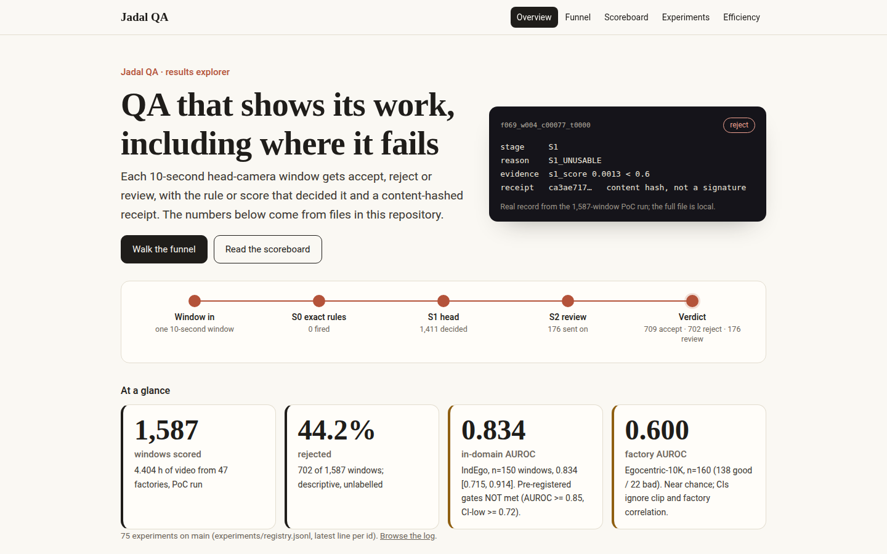
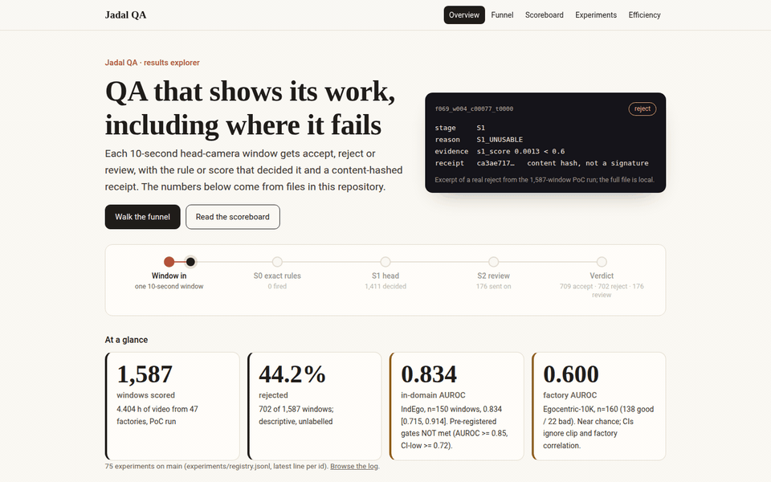
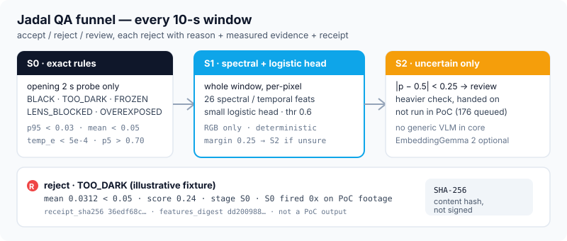
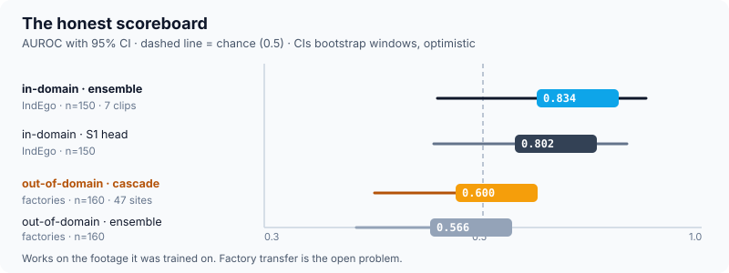

# Jadal QA

**QA for head-camera factory video that shows its evidence — including when it fails.**

<!-- BRAG_VIDEO_URL: paste the GitHub user-attachments URL of brag.mp4 here -->


*Launch video (35 s). Full video with sound: see the Releases page / upload placeholder.* Poster: [`docs/assets/brag_poster.jpg`](docs/assets/brag_poster.jpg).

[](https://parswanadh.github.io/jadal-qa/)

*The explorer is a static TypeScript app in [`site/`](site/). It is live at the link above once GitHub Pages is enabled for this repository.*



### Run the explorer locally

```bash
cd site
npm ci --ignore-scripts
npm run dev
```

Then open http://127.0.0.1:8874/. Tests: `npm test`; regenerate its baked data with `npm run data`.

Crowd-captured head-camera video is the raw material for robot learning. Much of it is
unusable: dark, blocked, frozen, duplicated, hands out of view, nothing happening.
Jadal QA is a deterministic funnel that marks each 10-second window
**accept / reject / review**, with a content-hashed receipt. S0 rejects carry
per-rule `{feature, value, op, threshold}`; S1 rejects carry the head score
`s1_score` against the 0.6 threshold (all 702 PoC rejects are `S1_UNUSABLE`).

| At a glance | Scope |
|---|---|
| Ensemble AUROC **0.834 [0.715, 0.914]** — pre-registered gates NOT met (AUROC >= 0.85, CI-low >= 0.72) | IndEgo, n=150 windows, 7 clips, nested leave-one-clip-out |
| Factory AUROC **0.600 [0.474, 0.724]**, rejects 53/138 good (38%) | Egocentric-10K, n=160 windows, 47 factories — close to chance; source: sync doc, results file pending merge |
| PoC run: **1,587 windows, 4.404 h, 702 rejected (44.2%)** | 47 factories, descriptive only (unlabelled) |
| **750 tests, OK** | merge gate on `main` at e320c58 (2026-10-10 21:49 IST); not re-run for this PR |

Sources: `eval/results/ensemble/nested_loco.json`,
`docs/pod/SYNC_UPDATE_2026-10-10_2145.md:22` (the 160-window OOD numbers),
`eval/results/poc/run_summary.json`. The OOD evaluation outputs
'ood_eval_*_160.txt' live in the pod data bundle (Hugging Face dataset repo
private pod data bundle) and are not yet merged — OOD rows below are
marked 'source: sync doc; results file pending merge'. CIs bootstrap windows and ignore
clip/factory correlation, so they are optimistic.





## Why it exists

- Robot-learning pipelines eat factory video. Bad clips waste labelling, training, and trust.
- Hand-checking every 10-second window does not scale across dozens of factories.
- Jadal rejects with checkable evidence: S0 rejects carry `{feature, value, op,
  threshold}` per firing rule; S1 rejects carry the head score `s1_score`
  against the 0.6 threshold.
- When the scorer fails out of domain, the table says so. That honesty is the point.

## How the funnel decides

- **S0 exact rules** on the opening probe: BLACK `p95 < 0.03`, TOO_DARK `mean < 0.05`,
  LENS_BLOCKED `spatial_var < 1e-5`, OVEREXPOSED `p5 > 0.70`, FROZEN `temp_e < 5e-4`.
  Each firing carries `{feature, value, op, threshold}`. On the PoC footage S0
  fired 0 times — all decisions fell to S1/S2 (`eval/results/poc/run_summary.json`).
- **S1 whole-window head**: 26 per-pixel spectral + temporal features, small
  logistic head retrained deterministically in-process from a recorded recipe
  on the 150 IndEgo windows (no frozen-coefficient file in the repo; the head
  sha256 is stored in each receipt), operating point threshold 0.6, margin
  0.25. S1 rejects carry `{feature: s1_score, value, op, threshold}` only.
  No generic VLM in
  the core; EmbeddingGemma 2 is an optional helper for hub search and frame heads.
- **S2 review queue**: `|p − 0.5| < 0.25` goes to review (176 windows in the PoC run,
  handed on; heavy tier not run in the PoC).
- Per-reason recall in-domain (reject at 0.5): TOO_DARK 1.00, HANDS_NOT_VISIBLE 0.86,
  NO_ACTIVE_WORK 0.70, DUPLICATE 0.67 (`eval/results/ensemble/nested_loco.json`).

## What a rejection looks like

A real record from the 1,587-window PoC run (`poc_data/windows.jsonl`, produced by
`scripts/poc_run.py`; the file is local and not in this repo). In that run S0 fired 0 times,
so all 702 rejects are stage-S1 `S1_UNUSABLE`, whose evidence is the `s1_score` against
the 0.6 threshold (not a per-feature explanation):

```json
{
  "window_id": "f069_w004_c00077_t0000",
  "verdict": "reject",
  "stage": "S1",
  "reasons": [
    {"code": "S1_UNUSABLE", "evidence": {"feature": "s1_score", "value": 0.0013, "op": "<", "threshold": 0.6}}
  ],
  "score": 0.0013,
  "features_digest": "4af5b2a6…",
  "receipt_sha256": "ca3ae717…"
}
```

`receipt_sha256` is the SHA-256 of the canonical JSON. Re-verify by re-running the
recorded pipeline version on the original clip and comparing hashes. Receipts are
content-hashed, **not signed**; same-machine determinism only.
See [`docs/ARCHITECTURE.md`](docs/ARCHITECTURE.md) and [`docs/reports/verify.md`](docs/reports/verify.md).

## The honest scoreboard

Out-of-domain result leads, not trails: the funnel scores above chance in-domain
on 7 clips (exploratory; weakest clip 0.606).
Factory transfer is the open problem, and the repo is organised to attack it.

| Result | n, source | AUROC [95% CI] | Status |
|---|---|---|---|
| Frozen ensemble, factory footage | 160 windows (138 good / 22 bad), 47 factories, one labeller | **0.566 (0.433–0.693)** | measured, near chance; source: sync doc, results file pending merge |
| PoC cascade, factory footage | same 160 | **0.600 (0.474–0.724)**, rejects 53/138 good (38%) | measured, near chance; source: sync doc, results file pending merge |
| 60-window precursor (ensemble / PoC) | 60 windows (51 good / 9 bad) | 0.415 [0.210, 0.647] / 0.529 [0.316, 0.728] | exploratory (`n_bad=9 < 10`), superseded by the 160-window rows |
| Ensemble prob-average, IndEgo | 150 windows, 7 clips, nested LOCO | **0.834 [0.715, 0.914]** | measured, exploratory (one labeller); pre-registered gates NOT met (AUROC >= 0.85, CI-low >= 0.72) |
| EG2 view / pixel view, IndEgo | same 150 | 0.846 [0.728, 0.913] / 0.792 [0.666, 0.882] | measured |
| S1 head (retrained in-process, recipe-recorded), IndEgo | same 150 | 0.802 [0.710, 0.870], thr 0.6 | measured |
| Per-pixel conv1d / HGB / physics-LR | same 150 | 0.782 / 0.758 / 0.715 | measured |
| PoC run reject share | 1,587 windows, 4.404 h, unlabelled | 702 rejected (44.2%) | descriptive, not accuracy |
| 3.33 fps vs 10 fps (26 feats) | IndEgo 150 | 0.807 vs 0.809 | descriptive, CIs ~±0.1 |
| Spatial-only 18 feats | IndEgo 150 | 0.678 vs 0.690 | descriptive, fairer comparison |
| Every-2nd-window sampling | IndEgo 150 | 51% of compute, error 0.049 | measured (tolerance post-hoc) |
| Early exit at 4 s | IndEgo 150 | 0.860 vs 0.848 at 10.5 s | measured in-window only |
| Combined x4.9 saving | — | arithmetic | **estimate, not measured** |

Files: `docs/pod/SYNC_UPDATE_2026-10-10_2145.md`,
`eval/results/ensemble/nested_loco.json`, `docs/reports/ensemble_views.md`,
`eval/results/gpu/cascade.json`, `eval/results/perpixel/compare.json`,
`eval/results/poc/run_summary.json`, `eval/results/poc/ood_check_60.json`,
`docs/reports/exp_fps.md`, `docs/reports/exp_temporal.md`,
`docs/reports/poc_run.md`, `docs/reports/perpixel_accuracy.md`.

Read it plainly: per-clip ensemble AUROC ranges 0.606 (pallet) to 0.981 (ecu_full);
pallet-type logistics motion does not transfer even in-domain
(`eval/results/ensemble/nested_loco.json:239-303`). Coverage from full to 60%
most-confident moves balanced accuracy 0.795 to 0.852, with overlapping CIs
(same file). On the 160 labelled windows, 53 of 66 rejects were good windows;
the other rejects of the 702 are unlabelled (`docs/reports/poc_run.md:86-87`). The
per-pixel pipeline processes 2.14 video-seconds per CPU-core-second (n=6 windows)
— 769 windows/hour/core, so 5000x real-time (a target, not reached) would need
~2340 cores (`eval/results/perpixel/cost.json`): a
verification-grade scorer, not the streaming tier.

## Try it in 60 seconds

Needs Python 3.12 (see [`docs/ARCHITECTURE.md`](docs/ARCHITECTURE.md) for the env).
Clips and model weights are **not** in git (see [`docs/ATTRIBUTIONS.md`](docs/ATTRIBUTIONS.md)).
These run without data:

```bash
git clone <repo-url> && cd <repo>
export PYTHONNOUSERSITE=1
PY=python3  # or your Python 3.12 env python

# full suite (Makefile: `make test`)
$PY -m unittest discover -s tests

# PoC self-check (no footage needed)
$PY scripts/poc_run.py --selfcheck 2

# receipt tool
$PY scripts/verify_receipt.py --help
$PY scripts/poc_run.py --help
```

With footage (IndEgo clips stay out of git; Egocentric-10K access is gated):

```bash
make demo        # service -> batches -> verdicts -> re-verify, IndEgo clips
bash scripts/poc_demo.sh   # one-command PoC launch, stream replay, Pico hook
```

Environment notes: the build uses a Python 3.12 env (see
[`docs/ARCHITECTURE.md`](docs/ARCHITECTURE.md)); set `PYTHONNOUSERSITE=1` so
user-site packages do not shadow it. `Makefile` pins one local interpreter path —
override `PY=` for your machine. Secrets come from a git-ignored `.env`.

## How it is built

**Determinism.** Same input plus same config and the recorded S1-head recipe gives the same
output: no sampling, fixed seeds, batch-size-1 model calls, floats rounded to
4 decimals before receipts. The S1 head is retrained deterministically in-process
from a recorded recipe on the 150 IndEgo windows; the head sha256 is stored in
each receipt (`docs/reports/poc_run.md:28-33`). The CPU feature-path digest was identical across
repeats and across 1-core vs 4-core runs (`docs/reports/edge.md:81-83`).
GPU numerics across devices are not claimed identical. See
[`docs/ARCHITECTURE.md`](docs/ARCHITECTURE.md).

**Receipts.** `jadal/receipts.py` writes segment hash, signals, decisions, verdict,
and config; `receipt_sha256` is the SHA-256 of the canonical JSON. An optional
HMAC sidecar exists (`jadal/receipt_mac.py`, `scripts/verify_receipt.py`).
A hash check proves self-consistency, not who wrote it. See
[`docs/reports/verify.md`](docs/reports/verify.md).

**Review + merge gate.** Every change goes through an agent review, then a
deterministic merge gate that runs the full suite on the merged tree
(750 tests at the merge gate on `main`, 2026-10-10; `Makefile`, `docs/process/`). Protected files
(`jadal/config.py`, `jadal/__init__.py`, `docs/SPEC.md`, `docs/BASELINE.md`)
are untouched by docs work.

**Experiment log.** The registry on `main` (`experiments/registry.jsonl`) has 75 experiments, latest line per id. An earlier snapshot in the pod bundle lists 138 experiment/component ids (E/L/B series); the two numbers are different sources and are not mixed. See `docs/pod/SYNC_UPDATE_2026-10-10_2145.md:50` and `docs/process/decision-log.md`.

**Edge tier.** The edge path pulls numpy, cv2, scipy, pillow + ImageHash — and no
torch, transformers, sklearn, fastapi, or CUDA (`docs/reports/edge.md`,
`requirements-edge.txt`). Pi ARM64 with mediapipe stays unverified; the proxy
fallback is the supported edge configuration until a real Pi run says otherwise.

## What we tried and dropped

- Spatial localisation **withdrawn**: pooled control 0.790 beats spatial grid 0.753
  (`docs/pod/SYNC_UPDATE_2026-10-10_2145.md:30`).
- Motion cue is "wearer not walking", not hand work: residual-flow magnitude is
  inverted (`docs/reports/ensemble_views.md:204-226`).
- Synthetic negatives harmful, not used (`docs/reports/ensemble_views.md:119`).
- Generic VLM stopped as too probabilistic and too expensive; not in the pipeline
  (`docs/ARCHITECTURE.md:25`). EmbeddingGemma 2 is an optional helper only.
- Guaranteed error bounds not achievable at n=150: support floor 86 exceeds the
  CERTIFY split; effective n ~11–43 with clip correlation
  (`docs/reports/funnel.md:460-469`).
- Purpose-built rhythm/conv network 0.782 vs simple HGB 0.758: kept frozen, not
  a win worth the complexity (`eval/results/perpixel/compare.json`,
  `docs/reports/perpixel_accuracy.md:54-56`).
- Deterministic 7-rule list ranks 0.589 and keeps 0.0 GOOD: rejected as decider,
  kept as evidence (`eval/results/perpixel/compare.json:58-62`).
- RGB only (3 bands). Not hyperspectral (`docs/ARCHITECTURE.md:26`).
- Pi compute run not measured; Pico is a status light only
  (`docs/reports/pico_hardware.md`).

## Repo map

```text
README.md               this file
docs/                   SPEC (binding), ARCHITECTURE, ATTRIBUTIONS, reports/, screens/, process/, pod/
docs/assets/            hand-drawn funnel + scoreboard SVGs
jadal/                  core package: signals, decision, funnel, certify, receipts, ensemble, perpixel, gpu, spectral, service
eval/                   harness, gold labels, results JSON (poc/, ensemble/, perpixel/, gpu/, exp_fps/, exp_temporal/)
configs/                frozen configs (ensemble_v1, perpixel_v1, funnel thresholds)
scripts/                demo, PoC run/replay/server, receipt verify, edge check
tests/                  34 files, 750 tests (fixtures/ has schema examples, no dataset frames)
web/                    static dashboard + PoC replay (mock/, poc/)
models/                 README only; weights git-ignored
pico/                   Pico MicroPython firmware (RP2040 status light)
sim/                    dock simulator (copies clips, posts ingest events)
sop/                    sample SOP (labelled SAMPLE) + index
voicebank/              messages + generator (wavs git-ignored)
tools/                  gold-label server only on this branch
```

## Roadmap (all planned, not done)

- Factory transfer via in-domain adaptation with grouped cross-validation by factory.
- Regime profiles + router, adopted only if they beat the global model under grouped CV.
- Mosaic evidence artefact (grid variants with timestamps + JSON sidecar).
- Cost model on a GPU pod (decode-bound ladder, continuous decode).
- Pi measurement: real compute run on Raspberry Pi hardware (never measured).

## Contributing / contact / licence

Licence: to be announced (not yet open-sourced). No `CONTRIBUTING` file on this
branch; open an issue or PR against `main` (never push to `main` directly).
Secrets live in env vars (`SARVAM_API_KEY`, `CF_API_TOKEN`, `CF_ACCOUNT_ID`)
via a git-ignored `.env` — never commit a key.

Credits: IndEgo (Fraunhofer IPK, CC BY 4.0, per the project brief, unverified;
see [`docs/ATTRIBUTIONS.md`](docs/ATTRIBUTIONS.md)) and Egocentric-10K-Evaluation
(Build AI, Apache-2.0 brief, per the project brief, unverified; AI labels from
gemini-2.5-flash, not human-checked)
are third-party datasets — see [`docs/ATTRIBUTIONS.md`](docs/ATTRIBUTIONS.md)
and each dataset's own licence. Dataset frames in this repo: `docs/screens/poc_*`
dashboard screenshots contain real Egocentric-10K thumbnails (checked: `file` on
all `docs/screens/*.png`, viewed `poc_gallery_rejects.png` and `poc_overview.png`;
see `docs/screens/README.md`); no raw dataset clips are in git
(`docs/screens/poc_demo_backup.mp4` is a synthetic card render, and
`eval/results/ensemble/ood_frames.npz` holds float16 768-d embeddings, not images).
A drop-videos portal is in progress (not in this repo).
