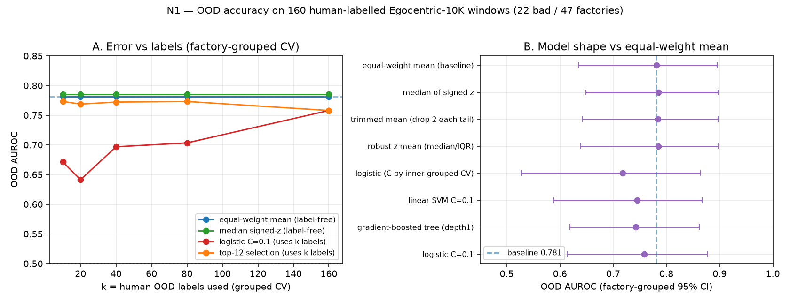

# N1 — Improving OOD accuracy: model shape, grouped-CV selection, adaptation, self-training

Branch `m/acc-adapt` (off `pod/base`) · experiments **N1.01–N1.03** (registry:
`experiments/registry.jsonl`; results: `eval/results/exp_acc/`) · figure:
`docs/experiments/exp_acc/images/n1_acc_adapt.png`.

**Goal.** Beat the current best out-of-domain score on the 160 human-labelled
Egocentric-10K windows — the O4 adaptation (Z3 transferable-6 **0.759** / stable-8+6
**0.781** AUROC, factory-grouped 95% CI [0.634, 0.895]) — honestly, under factory-grouped
CV, and produce an error-vs-labels curve.

**Baseline.** Equal-weight mean of the 14 transferable features (E5 stable-8 + Z3
transferable-6), per-domain z-score (unsupervised target mean/std), per-feature sign from
the 150 IndEgo gold windows: **AUROC 0.7810 [0.6344, 0.8952], BA 0.7325, error 0.2675**
(reproduces O4.01 exactly).

Every number: n, label source, protocol, 95% CI, device, command, `git_sha`. All evaluation
is factory-grouped — a factory is never in both train and test. No OOD threshold tuning.

## TL;DR

**No fitted model reliably beats the fixed equal-weight mean.** The best *point estimate* is a
**median aggregation** of the signed per-domain z-scores: **AUROC 0.7852 [0.649, 0.8968]**
(Δ **+0.004** vs baseline; paired factory-grouped bootstrap 60% of resamples > 0 — **not
significant**). The best *balanced error* recipe is a grouped-CV **top-12 selection**:
**BA 0.7408 [0.639, 0.843], error 0.2592** vs baseline 0.2675 (also not significant). Learned
combinations (logistic/SVM/GBT/stacking), test-time per-factory normalization, and
self-training on the 1,546 unlabelled windows all **fail** to beat the baseline. The features
are **not** domain-invariant (IndEgo-vs-OOD domain classifier AUROC **0.999**), and the
unlabelled 1,546 are themselves shifted from the OOD-160 (domain classifier AUROC **0.902**).

| # | recipe | OOD AUROC | grouped 95% CI | OOD BA | error |
|---|---|---|---|---|---|
| baseline | **equal-weight mean** (label-free) | 0.7810 | [0.6344, 0.8952] | **0.7325** | 0.2675 |
| 1 | **median of signed z** (label-free) | **0.7852** | **[0.6490, 0.8968]** | 0.7253 | 0.2747 |
| 1 | trimmed mean (drop 2 each tail) | 0.7839 | [0.6425, 0.8972] | 0.7325 | 0.2675 |
| 1 | robust z mean (median/IQR) | 0.7846 | [0.6378, 0.8979] | 0.7181 | 0.2819 |
| 1 | logistic (C by inner grouped CV) | 0.7174 | [0.5273, 0.8638] | 0.6479 | 0.3521 |
| 1 | logistic C=0.1 | 0.7579 | [0.6136, 0.8772] | 0.6924 | 0.3076 |
| 1 | linear SVM C=0.1 | 0.7447 | [0.5880, 0.8672] | 0.7260 | 0.2740 |
| 1 | gradient-boosted tree (depth-1) | 0.7428 | [0.6186, 0.8613] | 0.6805 | 0.3195 |
| 2 | **top-12 selection (grouped CV)** | 0.7813 | [0.6352, 0.8964] | **0.7408** | **0.2592** |
| 2 | top-4 / 6 / 8 / 10 selection | 0.775 / 0.733 / 0.759 / 0.773 | — | 0.691 / 0.655 / 0.693 / 0.674 | — |
| 2 | forward selection (grouped) | 0.7572 | [0.6142, 0.8777] | 0.6472 | 0.3528 |

## N1.01 — model shape, feature selection, adaptation (`eval/results/exp_acc/N1.01.json`)

**Model shape.** On the 14 transferable features (per-domain z-score), grouped 5-fold OOF:
the label-free aggregations (mean/median/trimmed/robust-z) are all ≈0.78 and statistically
indistinguishable; every *fitted* model is **below** the mean (logistic 0.758, SVM 0.745,
GBT 0.743, nested-C logistic 0.717). With only **22 bad windows over 47 factories**, a
fitted combination overfits; the equal-weight mean is the effective ceiling for these
features. Paired grouped bootstrap median−mean: **+0.0047 [−0.026, +0.040], 60% > 0**.

**Feature selection with grouped CV (not full-data).** Selecting the top-m features *inside
each fold* by train-fold signed AUROC does **not** beat the fixed 14-feature set: top-12
matches the baseline AUROC (0.781) but has the best balanced error (0.7408 / err 0.2592);
top-4/6/8/10 and forward selection are worse. Selection reduces AUROC or is neutral; its only
(not significant) benefit is a marginally better BA at threshold 0.

**Adaptation.**
- **(a) class-prior / importance weighting.** For the logistic, `class_weight='balanced'`
  raises BA (0.692 vs 0.489 unweighted) but leaves AUROC unchanged (0.758 vs 0.765); an
  explicit 13.75%-bad prior correction gives BA 0.722. Weighting affects the *operating
  point*, not the ranking — the baseline BA 0.733 already sits at a balanced operating point.
- **(b) domain classifier (diagnostic only, never in the decision path).** IndEgo vs OOD-160:
  AUROC **0.9994** (all-14) / **0.9838** (stable-8). The features are **strongly
  domain-separable** — they are *not* domain-invariant. Transfer works because of the
  unsupervised per-domain z-score, not because the features are invariant.
- **(c) test-time per-factory normalization** using each window's factory's **unlabelled**
  windows (1,546, from `windows_rescored.jsonl`). This **hurts badly**: stable-8 0.7269 →
  **0.3827**; mixing (stable-8 per-factory + Z3-6 global) 0.6426. The unlabelled pool is
  shifted (see below), so per-factory statistics are biased. Negative result.

## N1.02 — self-training on 1,546 unlabelled windows (`eval/results/exp_acc/N1.02.json`)

Protocol: for each outer grouped fold, pseudo-label the unlabelled windows whose factory is
**not** in the test fold (zero-shot IndEgo-signed stable-8 z-score), add the confident ones,
retrain, evaluate on held-out factories.

| | AUROC | BA | mean pseudo-labels |
|---|---|---|---|
| base stable-8 logistic (no self-train) | 0.7319 | 0.6561 | – |
| self-train `|z|>0.0` | 0.7273 | 0.6426 | 1236.8 |
| self-train `|z|>0.3` | 0.7299 | 0.6752 | 736.0 |
| self-train `|z|>0.5` | 0.7276 | 0.6624 | 462.4 |
| self-train `|z|>0.8` | 0.7250 | 0.6186 | 140.8 |

**Self-training does not help** (all ≤ the no-self-train base, and far below the 14-feature
zero-shot 0.781). Reason: the unlabelled 1,546 are shifted from the OOD-160 — a domain
classifier separates them at **AUROC 0.902** (stable-8) — and the stable-8 base is weaker
than the full transferable score, so pseudo-labels inject noise. Reported as a **negative
result**.

## N1.03 — best OOD score and error-vs-labels curve (`eval/results/exp_acc/N1.03.json`)

**Best OOD score (point estimate).** Median of the signed per-domain z-scores over the 14
transferable features: **AUROC 0.7852, factory-grouped 95% CI [0.649, 0.897]**, BA 0.7253.
Best balanced error: grouped-CV top-12 selection, **BA 0.7408 [0.639, 0.843], error 0.2592**.
Both improve the point estimate over the 0.781 / 0.2675 baseline but **neither is
significant** (paired grouped bootstrap CIs include 0). Honest verdict: **maybe / not
significant**.

**Error-vs-labels curve (k = 10 … 160, factory-grouped CV).**

| recipe \ k | 10 | 20 | 40 | 80 | 160 |
|---|---|---|---|---|---|
| equal-weight mean (label-free) | 0.781 | 0.781 | 0.781 | 0.781 | 0.781 |
| median signed-z (label-free) | 0.785 | 0.785 | 0.785 | 0.785 | 0.785 |
| logistic C=0.1 (uses k labels) | 0.671 | 0.641 | 0.697 | 0.703 | 0.758 |
| top-12 selection (uses k labels) | 0.773 | 0.769 | 0.772 | 0.773 | 0.758 |

The label-free transferable score is **flat in k** — it already uses no OOD labels. Recipes
that *learn from OOD labels* improve with k but **plateau below** the zero-shot transferable
score (logistic 0.758 @ k=160). On this set, **more human OOD labels do not buy accuracy
beyond the domain-adapted zero-shot score**; the label budget is better spent on the
per-domain adaptation (z-score) than on fitting a classifier.

## What worked / what failed

- **Worked (marginal):** robust aggregations — median (+0.004 AUROC) and trimmed mean (same
  BA, +0.003 AUROC); grouped-CV top-12 selection for balanced error (err 0.259 vs 0.268).
  All within noise.
- **Failed:** fitted classifiers (logistic/SVM/GBT/nested-C/stacking), IndEgo-augmented
  training, per-factory test-time normalization on unlabelled data, self-training.
- **Diagnostic:** features are not domain-invariant (0.999); the unlabelled pool is shifted
  (0.902); both explain the failures.

## Honesty / limits

- n_bad = **22** over **47** factories; the grouped CIs are wide and a few factories
  contribute many mixed windows. No result here is a significant improvement over 0.781.
- The 160 OOD windows are **one window per clip**, so true per-clip normalization is not
  testable on them; the per-factory variant uses the 1,546 *unlabelled* windows, which are
  shifted.
- The unlabelled 1,546 come from the same 47 factories as the 160 labels; self-training
  excludes the test factory in every fold, but the pool's distribution shift remains.
- The "best" point estimates were chosen from a small recipe library; with multiple
  comparisons the +0.004 median gain should be treated as **noise**, not a real gain.
