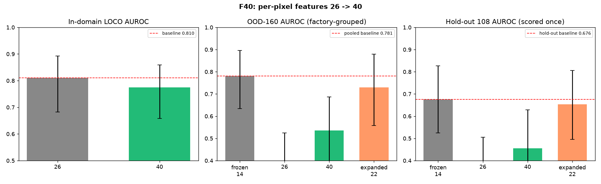

# F40 — per-pixel features 26 → 40: accuracy gain (in-domain LOCO + OOD grouped CI)

Branch `m/feat40` (off `pod/base`) · experiment **F40.01** (registry
`experiments/registry.jsonl`) · results `eval/results/exp_feat40/` · figure
`docs/experiments/exp_feat40/images/feat40.png` · device: CPU on the A40 pod host.

## Goal

Expand the per-pixel feature vector from **26 to 40** by adding **14** documented
features and measure the accuracy gain in-domain (LOCO) and out-of-domain
(factory-grouped CI on the 160 human-labelled Egocentric-10K windows), plus a
one-shot score of the 108 round-3 hold-out.

## Baselines to beat (documented, frozen)

| view | protocol | AUROC | source |
|---|---|---|---|
| 26 per-pixel | in-domain LOCO | **0.810** | `tools/port/baseline_logistic_loco.py` |
| frozen ensemble | OOD-160 (grouped, optimistic) | **0.566** | `docs/FACTS.md` |
| O4 adapted recipe (stable-8 + Z3-6) | OOD-160 pooled | **0.781** [0.634, 0.895] | `m/acc-adapt` N1.01 |
| O4 adapted recipe | hold-out 108 | **0.676** [0.525, 0.827] | `m/confirm` C1.01 |

## The 14 added features

See `docs/experiments/exp_feat40/README.md` for definitions and per-window cost.
Six are the **Z3 transferable set** (`ct_fsize_std`, `mo_hand_motion_excess`,
`inv_clip_frac`, `inv_laplacian_var`, `inv_hist_entropy`, `inv_dct_hf_lf`),
reused verbatim from the frozen caches. Eight are **fresh**:
three finer spectral radial bands (`spec_b1/b2/b3`), two colour-channel ratios
(`col_rg_ratio`, `col_bg_ratio`), two temporal-lag differences
(`temp_lag2`, `temp_lag3`) and a per-pixel noise floor (`noise_floor`).

## Results

**Verdict: DROP / negative.** Expanding 26 → 40 does **not** improve accuracy;
it hurts in-domain and the adapted-recipe OOD score, though the added features
do carry *some* transferable signal relative to the 26-only view.

### In-domain (LOCO, logistic C=0.3 balanced, clip-bootstrap 2000)

| view | AUROC | 95% CI (clip) | BA @0.5 |
|---|---|---|---|
| 26 per-pixel (baseline) | **0.8100** | [0.683, 0.892] | 0.740 |
| 40 per-pixel | 0.7750 | [0.658, 0.858] | 0.745 |

**Δ = −0.035** (40 worse). The 14 added features are not useful for the
in-domain logistic; the ablation confirms dropping them *raises* AUROC.

### OOD-160 (adapted per-domain-z-score, factory-grouped CI, n=160, 22 bad / 47 factories)

| feature set | AUROC | 95% CI (grouped) | BA @0.0 |
|---|---|---|---|
| **frozen O4 (stable-8 + Z3-6)** | **0.7810** | [0.634, 0.895] | 0.7325 |
| all 26 | 0.3864 | [0.231, 0.525] | 0.4127 |
| all 40 | 0.5352 | [0.355, 0.687] | 0.5264 |
| expanded-22 (stable-8 + Z3-6 + new-8) | 0.7302 | [0.557, 0.879] | 0.6607 |

The frozen 14-feature recipe (0.781) is **reproduced exactly**. Adding the 8
fresh features to it (expanded-22) **lowers** OOD AUROC to 0.730. The full
40-feature equal-weight score (0.535) is far below the selected frozen recipe,
but it **beats the 26-only score** (0.386): paired factory-grouped bootstrap
ΔAUROC(40 − 26) = **+0.150**, 95% CI [+0.018, +0.292], P(Δ>0)=0.987.

### Hold-out 108 (scored ONCE, no tuning; n=108, 16 bad / 44 factories)

| feature set | AUROC | 95% CI (grouped) | BA @0.0 |
|---|---|---|---|
| **frozen O4 (stable-8 + Z3-6)** | **0.6760** | [0.525, 0.827] | 0.6481 |
| all 26 | 0.3580 | [0.211, 0.505] | 0.3791 |
| all 40 | 0.4552 | [0.282, 0.628] | 0.4633 |
| expanded-22 (stable-8 + Z3-6 + new-8) | 0.6529 | [0.496, 0.806] | 0.6209 |

The frozen 0.676 is reproduced exactly. The 40-feature score (0.455) beats the
26-only (0.358) but sits well below the frozen recipe; expanded-22 (0.653) is
slightly below frozen. **No gain on the hold-out.**

## Ablation

**In-domain, leave-one-out over the 14 added features** (`delta = AUROC(40) −
AUROC(40 without f)`; negative = the feature hurts):

| dropped feature | AUROC without | delta |
|---|---|---|
| `ct_fsize_std` | 0.7848 | **−0.0098** |
| `mo_hand_motion_excess` | 0.7828 | **−0.0078** |
| `inv_dct_hf_lf` | 0.7794 | −0.0044 |
| `spec_b3` | 0.7790 | −0.0040 |
| `col_rg_ratio` | 0.7788 | −0.0038 |
| `spec_b2` | 0.7788 | −0.0038 |
| `noise_floor` | 0.7784 | −0.0034 |
| `inv_laplacian_var` | 0.7772 | −0.0022 |
| `spec_b1` / `temp_lag3` | 0.7756 | −0.0006 |
| `inv_clip_frac` | 0.7754 | −0.0004 |
| `col_bg_ratio` | 0.7750 | 0.0000 |
| `inv_hist_entropy` / `temp_lag2` | 0.7746 | +0.0004 |

Group ablations: dropping the whole `fresh8` block gives 0.7950 (+0.020 vs 40),
dropping `z3_6` gives 0.7908 (+0.016) — **both blocks hurt** in-domain. Dropping
`spectral3` 0.7830, `colour2` 0.7814, `temporal2` 0.7756, `noise1` 0.7784 — every
group is neutral-to-harmful in-domain.

**OOD, leave-one-out over the 14 added features on all-40** (positive delta = the
feature *carries* OOD signal):

| carries signal (delta>0) | hurts (delta<0) |
|---|---|
| `inv_dct_hf_lf` +0.029, `noise_floor` +0.021, `inv_laplacian_var` +0.021, `inv_hist_entropy` +0.020, `mo_hand_motion_excess` +0.018, `inv_clip_frac` +0.016, `spec_b2` +0.015, `spec_b1` +0.014, `ct_fsize_std` +0.013, `col_bg_ratio` +0.007 | `col_rg_ratio` −0.022, `temp_lag2` −0.017, `temp_lag3` −0.017, `spec_b3` −0.017 |

The **Z3-6 block carries most of the OOD signal**; the fresh-8 block is mixed
(spectral bands help weakly, the colour ratios and temporal lags hurt).

## Cost

End-to-end extraction of the 8 fresh features (decode + feature, 8-way process
pool, CPU, `OMP_NUM_THREADS=2`):

| set | n | errors | wall | ms/window |
|---|---|---|---|---|
| gold 150 (480p) | 150 | 0 | 56.6 s | 377 |
| OOD 160 (10-s label windows) | 160 | 0 | 96.6 s | 604 |
| hold-out 108 (1080p source) | 108 | 0 | 446.0 s | 4129 |

Single-window CPU time for the 8 new features alone is ≈0.3–2.2 s at 160×90
(≈300 frames); decode dominates, especially for the 1080p hold-out source clips.
The 6 Z3 features add no extraction cost here (reused from the frozen caches);
in the standalone extractor they cost one ffprobe pass (`ct_fsize_std`) plus
O(T·H·W) per frame.

## Honesty / limits

* **Negative result.** The 26 → 40 expansion is **not adopted**: in-domain LOCO
  drops 0.810 → 0.775 and the frozen adapted recipe (0.781 pooled / 0.676
  hold-out) is **not beaten** by any 40-feature variant.
* The only positive sub-result is that the all-40 equal-weight adapted score
  beats the all-26 one on OOD (+0.150, grouped CI [+0.018, +0.292]) and on the
  hold-out (0.455 vs 0.358) — i.e. the added transferable features help *relative
  to an unselected 26-feature mean*, but a **selected** 14-feature recipe is
  still clearly better.
* OOD n_bad = 22 over 47 factories (one window per clip); the grouped CI is
  optimistic. Hold-out n_bad = 16 over 44 factories, scored once, no tuning.
* Features 1–6 are reused from the frozen Z3 caches to reproduce the baseline
  exactly; features 7–14 are computed fresh. `mo_hand_motion_excess` in the
  standalone extractor uses a translation-only residual proxy (no phase
  correlation), so its fresh values differ slightly from the frozen cache — the
  evaluation uses the cached values.
* Multiple comparisons: the per-feature OOD ablation deltas are small and not
  corrected; treat them as descriptive.
* Device: CPU on the A40 pod host. Command:
  `OMP_NUM_THREADS=2 python3 eval/gpu/run_features40.py && python3 eval/exp_feat40/run_eval.py`.

