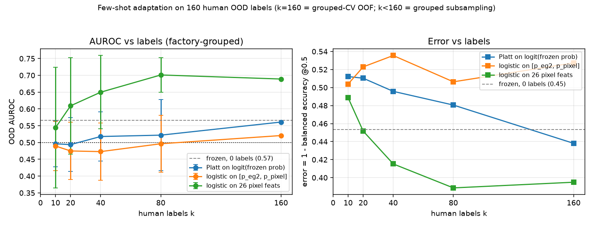

# O2 — E5.04 final + few-shot adaptation curve on 160 OOD labels

Branch `m/fewshot160` (off `pod/base`). Experiments **O2.01–O2.03** (registry:
`experiments/registry.jsonl`; results: `eval/results/exp_fewshot/`). This work
**finishes E5.04** (was *inconclusive* because `ood_labels2.json` was not
delivered) and adds the **error-vs-labels adaptation curve** the lead asked for.

All numbers come from a committed results JSON; every JSON carries `n`,
`label_source`, `protocol`, `ci95`, `device`, `command`, `git_sha`. Reproduce:

```
OMP_NUM_THREADS=2 python3 eval/exp_fewshot/prep_inputs.py --jobs 2
OMP_NUM_THREADS=2 python3 eval/exp_fewshot/run_o2.py all
python3 eval/exp_fewshot/make_figure.py
```

## TL;DR

| id | question | headline | verdict |
|---|---|---|---|
| O2.01 (E5.04) | does the frozen ensemble score the 160 human OOD windows? | **0.566** AUROC, **factory-grouped** CI **[0.445, 0.674]** (includes 0.5); bal.acc 0.546 [0.460, 0.635] | **drop** (was inconclusive) |
| O2.02 | how much does error drop per human label? | 26-pixel logistic: 0 → 0.566 AUROC / err 0.454; **40 labels → 0.650 / 0.415**; **80 → 0.701 / 0.389**; 160 (grouped-CV) **0.689 [0.510, 0.847] / 0.395** | **maybe** (best recipe) |
| O2.03 | which per-feature signs hold on the 160 labels? | **8 stable, 14 flip, 4 chance** (same counts as the 60); 2 features change class vs the 60 (`frozen_frac` flip→stable, `global_shift` stable→flip) | **maybe** |

## E5.04 final (O2.01) — `eval/results/exp_fewshot/O2.01.json`

The 100-window second batch is now labelled (`labels/ood_labels2.json`, batch
q2) and merged into `labels/ood160_labels.json`: **160 windows, 138 good /
22 bad, 47 factories** (was 60 windows, 51/9). n_bad = 22 (was 9).

Frozen `ensemble_v1` `usable_prob`, no tuning:

| metric | value |
|---|---|
| AUROC | **0.566** |
| AUROC 95% CI, **factory-grouped cluster bootstrap** (primary) | **[0.445, 0.674]** |
| AUROC 95% CI, window bootstrap (optimistic; matches `docs/ood_eval_ensemble_v1_160.txt`) | [0.437, 0.694] |
| balanced accuracy @0.5 | **0.546** [0.460, 0.635] |
| accuracy @0.5 | 0.481 |
| mean prob good / bad | 0.567 / 0.513 |
| p_eg2 AUROC / p_pixel AUROC | 0.589 / 0.520 |

**Verdict: drop.** The point estimate is above chance (0.566), but the honest
factory-grouped CI includes 0.5 and balanced accuracy is barely over 0.5 — the
frozen IndEgo ensemble is **not a reliable out-of-domain scorer** on its own.
This updates E5.04 from *inconclusive* to a **negative result**.

**Batch caveat (descriptive).** Pooling hides a batch split: batch q1 (the old
60) scores **0.415** (below chance, as E5.00 found), while batch q2 (new 100)
scores **0.657**. The two batches are different windows/clips; the pooled 0.566
is not a stable rate. Batch is not a random split, so this is descriptive only.

## Few-shot adaptation curve (O2.02) — `eval/results/exp_fewshot/O2.02.json`

Protocol: **factory-grouped CV only** — a factory never appears in both train
and test. For k < 160: repeated (20×) factory-grouped subsampling (train on
~k windows, test on the factory-disjoint complement; inner leave-one-factory-out
on the train factories picks C ∈ {0.01, 0.1, 1, 10}; balanced class weights).
For k = 160: `StratifiedGroupKFold(5, groups=factory)` OOF over all 160.
`error = 1 − balanced accuracy @0.5` (0.5 threshold; class-imbalanced set).

**AUROC vs k**

| recipe \ k | 0 (frozen) | 10 | 20 | 40 | 80 | 160 (grouped-CV) |
|---|---|---|---|---|---|---|
| frozen `usable_prob`, no training | **0.566** | – | – | – | – | – |
| Platt calibrator on logit(frozen prob) | 0.566 | 0.496 | 0.494 | 0.518 | 0.522 | 0.561 [0.421, 0.698] |
| logistic on [p_eg2, p_pixel] | 0.566 | 0.490 | 0.475 | 0.473 | 0.496 | 0.521 [0.361, 0.664] |
| **logistic on 26 pixel feats (10 fps-effective)** | 0.566 | 0.544 | 0.609 | **0.650** | **0.701** | **0.689** [0.510, 0.847] |

**Error (= 1 − balanced accuracy) vs k** — the curve the lead asked for

| recipe \ k | 0 (frozen) | 10 | 20 | 40 | 80 | 160 (grouped-CV) |
|---|---|---|---|---|---|---|
| frozen `usable_prob`, no training | **0.454** | – | – | – | – | – |
| Platt calibrator | 0.454 | 0.512 | 0.510 | 0.496 | 0.481 | 0.438 |
| logistic on [p_eg2, p_pixel] | 0.454 | 0.504 | 0.523 | 0.536 | 0.506 | 0.527 |
| **logistic on 26 pixel feats** | 0.454 | 0.489 | 0.452 | **0.415** | **0.389** | **0.395** |



**Reading the curve.**

- **Only the 26-pixel recipe adapts.** The two recipes that reuse the frozen
  ensemble views (Platt on `usable_prob`, logistic on `[p_eg2, p_pixel]`) stay at
  chance for every k; the frozen views carry no recoverable OOD signal even
  after calibration. The adaptation gain comes from the **per-pixel features**,
  not from re-weighting the ensemble outputs.
- **Marginal return per label (pixel-26, k ≤ 160):** AUROC +0.157 from 10 → 80
  labels (~0.0022/label), error −0.100 over the same span (~0.0014/label).
  Most of the gain is between **20 and 80 labels**; the 10-label point is noisy
  (std 0.18, only 13/20 repeats survived, and a training fold can hold a single
  bad example).
- **Best label-efficient recipe:** logistic on the 26 per-pixel features.
  Measured at the full set (O2.02, grouped-CV OOF): **AUROC 0.689
  [0.510, 0.847], balanced accuracy 0.605, error 0.395** vs the frozen
  ensemble's 0.566 / 0.546 / 0.454. Recommended operating point: **~40–80
  labels** (AUROC 0.65–0.70, error 0.39–0.42); 80 labels already reaches the
  160-label CV level.

**Caveats.** k = 160 is a grouped-CV OOF point (each window held out once;
training folds ≈ 128 labels), not a subsample; the other k are grouped
subsamples, so the 80 and 160 points are not perfectly comparable. With n_bad =
22 and ~1 window/factory, all points remain optimistic for deployment, and the
10–20 label points sit close to a single-example signal (`min_n_bad_train = 1`).

## E5.03 refresh (O2.03) — `eval/results/exp_fewshot/O2.03.json`

Signed AUROC per feature (label 1 = usable/good). IndEgo = 150 human gold
windows (clip bootstrap over 7 clips); OOD160 = 160 human windows (10
fps-effective), **factory-grouped** bootstrap; OOD60 = the old 60 (window
bootstrap). Classification rule unchanged (`e5lib.classify_transfer`: chance iff
**both** domains |AUROC − 0.5| < 0.05; else stable/flip by sign).

Forward table (features with the strongest OOD-160 signal first; full table in
the JSON). `cls60 → cls160` shows the change against the old 60-label table.

| feature | IndEgo | OOD160 10 fps | OOD160 grouped CI | OOD60 (old) | class (60 → 160) |
|---|---|---|---|---|---|
| pca_resid | 0.449 | 0.717 | [0.54, 0.86] | 0.693 | flip → flip |
| dct_energy | 0.631 | 0.700 | [0.55, 0.83] | 0.702 | stable → **stable** |
| luma_p95 | 0.499 | 0.689 | [0.53, 0.83] | 0.723 | flip → flip |
| illum_b | 0.528 | 0.686 | [0.54, 0.82] | 0.763 | stable → **stable** |
| bright_frac | 0.371 | 0.679 | [0.48, 0.85] | 0.678 | flip → flip |
| hf_ratio | 0.618 | 0.657 | [0.50, 0.80] | 0.693 | stable → **stable** |
| motion_energy | 0.308 | 0.646 | [0.52, 0.78] | 0.721 | flip → flip |
| illum_g | 0.401 | 0.644 | [0.50, 0.79] | 0.695 | flip → flip |
| temp_b2 | 0.287 | 0.639 | [0.52, 0.78] | 0.695 | flip → flip |
| radial_slope | 0.633 | 0.635 | [0.48, 0.78] | 0.645 | stable → **stable** |
| frozen_frac | 0.624 | 0.532 | [0.47, 0.58] | 0.497 | flip → **stable** |
| luma_p05 | 0.392 | 0.442 | [0.28, 0.59] | 0.473 | stable → **stable** |
| illum_r | 0.490 | 0.255 | [0.14, 0.38] | 0.163 | stable → **stable** |

**Counts: 8 stable, 14 flip, 4 chance (26 total)** — identical to the old
60-label table. Only **2 of 26** features changed class when moving from 60 to
160 labels:

- `frozen_frac`: flip → **stable** (OOD60 0.497 ≈ chance, OOD160 0.532, IndEgo 0.624)
- `global_shift`: stable → **flip** (OOD60 0.461, OOD160 0.509 crosses 0.5)

So the what-transfers table is **robust to doubling the label set**: the same
sharpness/spatial-spectrum group holds, and the motion / temporal-band group
still inverts.

**Recommended transferable feature subset** (class `stable` **and** informative
in at least one domain, |AUROC − 0.5| ≥ 0.10): **`dct_energy`, `hf_ratio`,
`radial_slope`, `luma_p05`, `illum_b`, `illum_r`, `frozen_frac`** (7 features).

- The **sharpness/spatial-spectrum trio** `radial_slope`, `hf_ratio`,
  `dct_energy` stays sign-stable and is weakly informative out-of-domain
  (OOD160 0.63–0.70); `dct_energy` now has a grouped CI that excludes 0.5
  ([0.55, 0.83]). This is the safest cue group for adaptation (and is exactly
  what the successful O2.02 pixel-26 recipe relies on).
- `illum_r` / `illum_b` / `luma_p05` / `frozen_frac` are *stable* but weak
  (|AUROC − 0.5| mostly < 0.15, CIs wide): keep as weak sign priors only.
- Do **not** reuse the motion/temporal-band signs (`motion_energy`, `temp_b0–b3`)
  across domains — they still flip.

## Recommendation

1. **Drop the frozen ensemble as a standalone OOD gate** (O2.01: 0.566, grouped
   CI includes 0.5). Report E5.04 as a negative result.
2. **Adapt with the 26-pixel logistic** (O2.02): ~40 labels → AUROC 0.65 /
   error 0.42; ~80 labels → AUROC 0.70 / error 0.39; full 160-labels grouped-CV
   → AUROC 0.689 [0.510, 0.847] / error 0.395. The frozen-view calibrators do
   **not** help — spend labels on pixel features, not on ensembling the frozen
   views.
3. **Regime-routing feature subset** (O2.03): `dct_energy`, `hf_ratio`,
   `radial_slope` (+ weak `luma_p05`, `illum_b`, `illum_r`, `frozen_frac`).

## Caveats

- OOD = **160 human windows, 22 bad, 47 factories, single labeller**; ~1
  window/factory, so every CI is wide and all numbers are exploratory. The
  factory-grouped bootstrap is the honest CI; the window bootstrap is optimistic.
- Batch q1 (old 60) and q2 (new 100) score very differently (0.415 vs 0.657);
  the pooled 0.566 is not a stable rate.
- O2.02 k < 160 uses grouped subsampling; k = 160 uses grouped 5-fold OOF
  (≈128 training labels per fold). Not perfectly comparable, both factory-grouped.
- No labels were edited. The 160 labels (`labels/ood160_labels.json`) are inputs.
