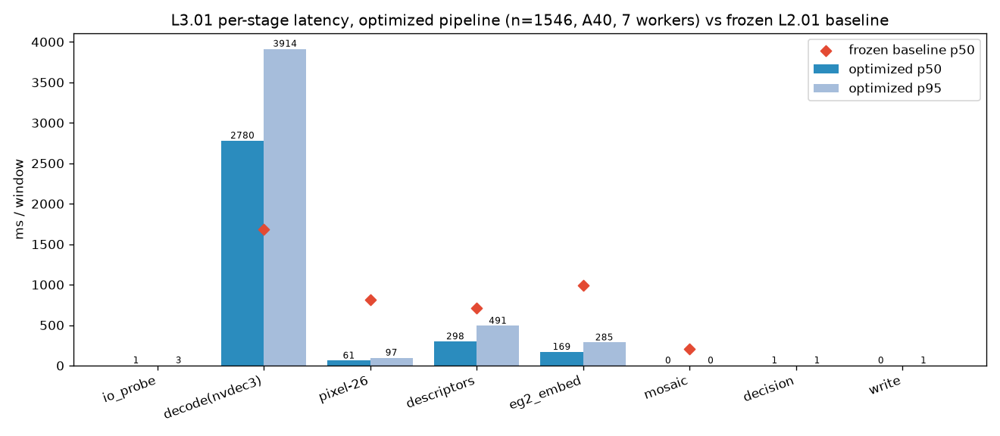
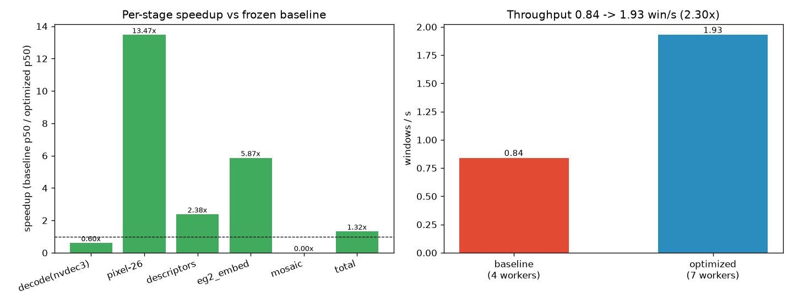

# L3.01 — Full-corpus pipeline at full resources + adopted optimizations

**Registry id:** L3.01 · **Branch:** `m/latency-fast` · **Device:** A40 · **git_sha:** `ae2df45f4e98348716dafb2dab979cf5f31e3c5f`

## What this is

The **same harness as L2.01** (`eval/exp_latency_fast/run_fast.py` imports the repo E8.01 pipeline and only inserts `perf_counter`), run over the full **1,546-window / 58-clip / 4.404 h** Egocentric-10K corpus at **full resources** (`--workers 7` on the 7.65-core cgroup, `JADAL_GPU_SLOTS=6`, NVDEC three-branch decode) with the pod's **adopted optimizations** applied. The scoring code (`ensemble_prob`/`verdict_for`/`features_block`) is unchanged, so verdicts stay comparable.

### Adopted optimizations applied

| id | change | flag |
|---|---|---|
| E1.01 | pixel-26 view at 3.33 fps (~34 vs ~300 frames) | `--pixel-fps 3.33` |
| E1.02 | EG2 view at 1 fps (10 vs 20 images) | `--eg2-fps 1.0` |
| E3.03 | observe only the first 4 s of a 10 s window | `--early-exit-s 4.0` |
| E3.01 | every-2nd-window grid (separate stride-2 run below) | `--window-stride 1` |
| E2 | skip the mosaic evidence artifact (not a model input) | `--skip-mosaic True` |
| X1 | 360p@CRF28 source | not applied — not applied (corpus ships 1080p HEVC only; X1 is a bytes win, not a decode-compute win on local disk) |

Frames actually decoded per window (p50): pixel 13.0, EG2 4.0, native 3.0.

## Throughput (full corpus, measured)

- **Wall:** 801.28 s (13.35 min) · **1.9294 windows/s** · **19.786 footage-h / wall-h** (corpus 4.404 h)
- Per window: mean 3533.4 ms, p50 3356.7 ms, p95 4625.6 ms · 7 workers, `OMP_NUM_THREADS=1`
- vs frozen baseline **0.84 windows/s** → **2.297x** throughput (2.297x footage-h/wall-h); per-worker-normalized 1.313x.

## Per-stage latency (ms / window) vs baseline

| stage | p50 | p95 | p99 | mean | share | baseline p50 | speedup |
|---|---|---|---|---|---|---|---|
| io_probe | 1.49 | 2.68 | 4.09 | 1.66 | 0.05% | — | — |
| decode(nvdec3) | 2779.72 | 3914.28 | 4726.82 | 2884.84 | 81.65% | 1679.0 | 0.604x |
| pixel-26 | 60.67 | 96.61 | 200.99 | 65.76 | 1.86% | 817.0 | 13.466x |
| descriptors | 297.87 | 491.11 | 847.34 | 333.48 | 9.44% | 709.0 | 2.38x |
| eg2_embed | 168.9 | 285.35 | 399.39 | 246.03 | 6.96% | 991.0 | 5.867x |
| mosaic | 0.0 | 0.0 | 0.0 | 0.0 | 0.0% | 204.0 | — |
| decision | 0.99 | 1.13 | 1.64 | 1.16 | 0.03% | — | — |
| write | 0.4 | 0.79 | 0.88 | 0.46 | 0.01% | — | — |

**Bottleneck:** `decode(nvdec3)` (2884.84 ms mean, 81.65% of the per-window total).

### Clean (uncontended, 1 worker) per-window cost

The 7-worker run serialises on the single A40 NVDEC engine, which inflates per-window decode. A 1-worker probe on the same optimized pipeline recovers the uncontended per-stage cost:

| stage | p50 | baseline p50 | speedup |
|---|---|---|---|
| decode(nvdec3) | None | 1679.0 | — |
| pixel-26 | None | 817.0 | — |
| descriptors | 344.5 | 709.0 | 2.058x |
| eg2_embed | 150.2 | 991.0 | 6.598x |
| mosaic | 0.0 | 204.0 | — |
| **total** | **1482.6** | **4437** | **2.993x** |

1-worker decode: 4 s p50 1332.2 ms vs 10 s p50 1756.2 ms — early exit saves only ~24% of decode because container seek + NVDEC setup dominate, not frame count.

## Outcomes vs the frozen baseline

- **Windows:** 1546 processed, failures 0.

| verdict | L3 n | L3 share | frozen baseline n | share |
|---|---|---|---|---|
| accept | 876 | 56.66% | 296 | 19.15% |
| reject | 40 | 2.59% | 83 | 5.37% |
| review | 630 | 40.75% | 1167 | 75.49% |

Per-window verdict agreement with the E8.01 reference: **54.33%** (1546 compared, 706 mismatches). Profile distribution `{'default': 11, 'factory_1080p30': 1535}`. verdicts are DESCRIPTIVE (no labels). The optimized run uses sparser sampling, so verdicts need not be bit-identical; the distribution should be close.

### Score / verdict shift under sparse sampling (frozen heads)

- Frozen-head score mean: reference 0.4858 → optimized **0.6874** (Δ **+0.2016**, Δp50 +0.1214).
## Adopted every-2nd policy (E3.01)

- **Derived** from the stride-1 run: same 1.9294 windows/s, but each processed window represents 2 windows of footage → **39.572 footage-h/wall-h** (4.594x vs baseline).
- **Measured** (stride-2 run, partly contended by a concurrent pod job): 773 windows, wall 482.17 s, **1.6032 windows/s**, **32.881 footage-h/wall-h** → **1.909x** throughput / **3.817x** footage vs baseline.

## GPU / CPU

- GPU util over the run: p50 14.0%, mean 27.95%, p95 96.15%.
- VRAM peak (nvidia-smi): 16798.0 MiB of 46068 MiB; EG2 per-window torch peak p50 1583.08 MiB.
- CPU: 7 workers on the 7.65-core cgroup quota, `OMP_NUM_THREADS=1`.

## Per-clip table

| clip | factory | n win | mean total ms | p95 ms | mean decode ms | mean eg2 ms | serial s |
|---|---|---|---|---|---|---|---|
| factory001_worker006_00008.mp4 | factory_001 | 119 | 4059.1 | 16558.8 | 2762.3 | 912.2 | 483.0 |
| factory003_worker004_00003.mp4 | factory_003 | 119 | 3282.6 | 3900.6 | 2712.8 | 185.5 | 390.6 |
| factory009_worker001_00007.mp4 | factory_009 | 119 | 3299.8 | 3869.2 | 2745.0 | 193.2 | 392.7 |
| factory010_worker002_00056.mp4 | factory_010 | 17 | 3177.8 | 3564.6 | 2628.7 | 177.4 | 54.0 |
| factory013_worker008_00166.mp4 | factory_013 | 17 | 3619.3 | 4343.6 | 3018.0 | 193.8 | 61.5 |
| factory014_worker041_00143.mp4 | factory_014 | 17 | 3210.0 | 3655.2 | 2555.2 | 199.2 | 54.6 |
| factory016_worker002_00008.mp4 | factory_016 | 52 | 3291.6 | 3909.8 | 2752.8 | 176.1 | 171.2 |
| factory019_worker007_00033.mp4 | factory_019 | 17 | 3188.0 | 3979.0 | 2606.0 | 182.9 | 54.2 |
| factory020_worker002_00157.mp4 | factory_020 | 17 | 3340.9 | 3876.6 | 2753.5 | 197.7 | 56.8 |
| factory020_worker002_00158.mp4 | factory_020 | 18 | 3834.4 | 4497.3 | 3274.0 | 168.7 | 69.0 |
| factory020_worker002_00159.mp4 | factory_020 | 17 | 3703.1 | 4389.7 | 3146.7 | 177.9 | 63.0 |
| factory021_worker012_00110.mp4 | factory_021 | 17 | 3824.6 | 4432.8 | 3188.1 | 206.6 | 65.0 |
| factory022_worker008_00154.mp4 | factory_022 | 17 | 4103.2 | 4549.2 | 3547.6 | 172.5 | 69.8 |
| factory023_worker003_00055.mp4 | factory_023 | 17 | 3916.6 | 4324.5 | 3343.7 | 164.2 | 66.6 |
| factory024_worker005_00022.mp4 | factory_024 | 17 | 3483.2 | 4178.0 | 2830.7 | 229.8 | 59.2 |
| factory024_worker005_00023.mp4 | factory_024 | 17 | 3292.3 | 3950.7 | 2723.9 | 185.3 | 56.0 |
| factory024_worker005_00024.mp4 | factory_024 | 17 | 3150.3 | 3689.6 | 2568.9 | 191.0 | 53.6 |
| factory026_worker005_00111.mp4 | factory_026 | 17 | 3158.9 | 3581.1 | 2587.0 | 192.0 | 53.7 |
| factory028_worker001_00022.mp4 | factory_028 | 17 | 3449.7 | 4118.9 | 2843.3 | 198.1 | 58.6 |
| factory028_worker001_00023.mp4 | factory_028 | 17 | 3314.3 | 3691.8 | 2658.3 | 235.9 | 56.3 |
| factory029_worker002_01846.mp4 | factory_029 | 17 | 3062.5 | 3518.9 | 2514.1 | 165.4 | 52.1 |
| factory033_worker009_00000.mp4 | factory_033 | 17 | 3184.0 | 3600.2 | 2638.9 | 182.1 | 54.1 |
| factory035_worker014_00077.mp4 | factory_035 | 17 | 3218.0 | 4182.1 | 2633.4 | 195.6 | 54.7 |
| factory036_worker007_00011.mp4 | factory_036 | 17 | 3088.2 | 3668.3 | 2527.3 | 182.0 | 52.5 |
| factory037_worker018_00124.mp4 | factory_037 | 17 | 3368.7 | 4129.4 | 2798.6 | 181.8 | 57.3 |
| factory038_worker029_00022.mp4 | factory_038 | 17 | 3249.2 | 3783.4 | 2672.4 | 181.8 | 55.2 |
| factory039_worker006_01017.mp4 | factory_039 | 17 | 3254.8 | 3586.2 | 2666.4 | 170.6 | 55.3 |
| factory039_worker006_01018.mp4 | factory_039 | 17 | 3585.7 | 4024.6 | 2888.6 | 208.7 | 61.0 |
| factory040_worker001_00026.mp4 | factory_040 | 117 | 3459.0 | 4477.7 | 2882.3 | 190.4 | 404.7 |
| factory041_worker042_00077.mp4 | factory_041 | 18 | 3693.6 | 4477.1 | 3178.6 | 184.3 | 66.5 |
| factory042_worker010_00056.mp4 | factory_042 | 18 | 3645.4 | 4773.2 | 3089.2 | 197.8 | 65.6 |
| factory044_worker014_00056.mp4 | factory_044 | 18 | 3813.4 | 4840.0 | 3166.6 | 200.2 | 68.6 |
| factory046_worker008_00618.mp4 | factory_046 | 17 | 3553.6 | 4275.3 | 2991.4 | 179.1 | 60.4 |
| factory051_worker005_00166.mp4 | factory_051 | 17 | 3299.5 | 3877.8 | 2724.4 | 180.1 | 56.1 |
| factory051_worker005_00167.mp4 | factory_051 | 17 | 3429.2 | 4150.5 | 2795.9 | 192.9 | 58.3 |
| factory053_worker038_00154.mp4 | factory_053 | 17 | 3448.1 | 3940.1 | 2848.0 | 206.1 | 58.6 |
| factory054_worker002_00045.mp4 | factory_054 | 18 | 3274.5 | 3677.5 | 2698.7 | 180.8 | 58.9 |
| factory056_worker016_00154.mp4 | factory_056 | 17 | 3364.0 | 3692.0 | 2767.5 | 158.3 | 57.2 |
| factory057_worker021_00154.mp4 | factory_057 | 17 | 3985.5 | 4714.0 | 3278.4 | 238.7 | 67.8 |
| factory057_worker021_00155.mp4 | factory_057 | 17 | 3475.9 | 4134.8 | 2856.6 | 191.2 | 59.1 |
| factory058_worker003_00121.mp4 | factory_058 | 17 | 2952.7 | 3136.5 | 2402.8 | 170.4 | 50.2 |
| factory058_worker003_00122.mp4 | factory_058 | 17 | 3286.8 | 3819.0 | 2688.5 | 199.8 | 55.9 |
| factory060_worker008_00099.mp4 | factory_060 | 17 | 3385.4 | 3869.1 | 2804.6 | 184.2 | 57.6 |
| factory061_worker007_00036.mp4 | factory_061 | 119 | 3352.1 | 4133.5 | 2797.3 | 183.5 | 398.9 |
| factory062_worker014_00099.mp4 | factory_062 | 18 | 4004.3 | 4819.3 | 3398.3 | 183.3 | 72.1 |
| factory066_worker015_00088.mp4 | factory_066 | 18 | 4468.4 | 5074.6 | 3933.9 | 160.7 | 80.4 |
| factory068_worker014_00077.mp4 | factory_068 | 18 | 3711.6 | 4331.8 | 3165.6 | 174.7 | 66.8 |
| factory069_worker004_00077.mp4 | factory_069 | 18 | 3570.4 | 4095.3 | 3013.2 | 182.8 | 64.3 |
| factory069_worker004_00078.mp4 | factory_069 | 18 | 3385.0 | 3946.8 | 2830.9 | 182.6 | 60.9 |
| factory070_worker031_00066.mp4 | factory_070 | 18 | 3249.2 | 3674.4 | 2678.0 | 201.5 | 58.5 |
| factory073_worker014_00055.mp4 | factory_073 | 18 | 3429.3 | 3814.0 | 2891.5 | 175.5 | 61.7 |
| factory076_worker061_00066.mp4 | factory_076 | 18 | 3253.5 | 3670.6 | 2691.6 | 189.4 | 58.6 |
| factory077_worker006_00056.mp4 | factory_077 | 18 | 3199.8 | 3515.7 | 2643.3 | 172.9 | 57.6 |
| factory077_worker006_00057.mp4 | factory_077 | 18 | 3576.9 | 3981.4 | 2997.7 | 191.1 | 64.4 |
| factory079_worker023_00000.mp4 | factory_079 | 18 | 3776.9 | 4733.9 | 3055.1 | 192.6 | 68.0 |
| factory080_worker020_00066.mp4 | factory_080 | 18 | 5154.5 | 7005.8 | 4044.2 | 266.9 | 92.8 |
| factory084_worker008_00033.mp4 | factory_084 | 17 | 5558.1 | 6413.9 | 4508.2 | 226.7 | 94.5 |
| factory085_worker017_00000.mp4 | factory_085 | 17 | 5070.1 | 5561.2 | 4112.5 | 309.4 | 86.2 |

## Figures

## Caveats

- peer opencode jobs shared the pod during the run (a concurrent baseline re-run held ~4 cores on the same 7.65-core cgroup); the frozen baseline p50s were themselves measured under pod load ~10-13/96.
- Verdicts are **descriptive** (no human labels for these windows); the accept/reject share is not a quality measure. Sparser sampling can change individual verdicts; only the distribution is expected to stay close.
- Early exit observes only 4 s, so the native descriptor branch yields ~3 frames instead of 8 (documented in `contract.versions.sampling`).
- X1 (360p@CRF28) was not applied: the corpus ships 1080p HEVC only and the pipeline reads local disk, so the X1 win (bytes) does not reduce decode compute.
