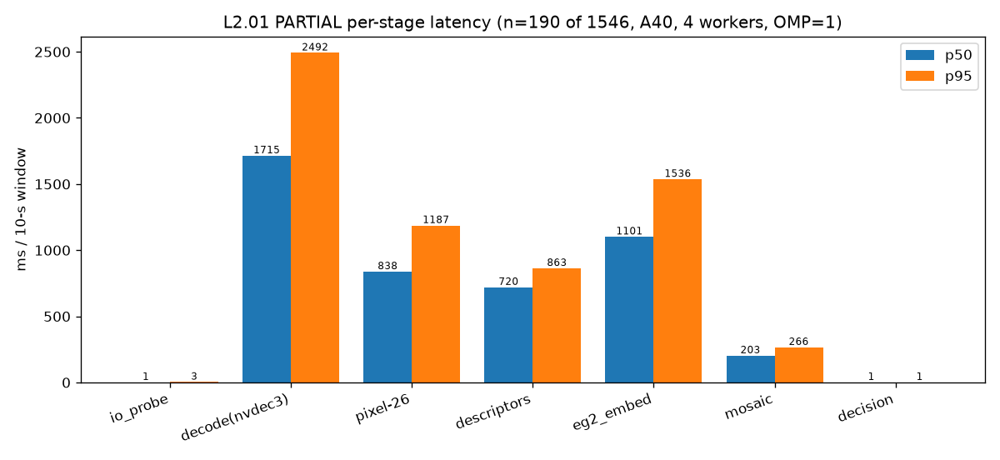
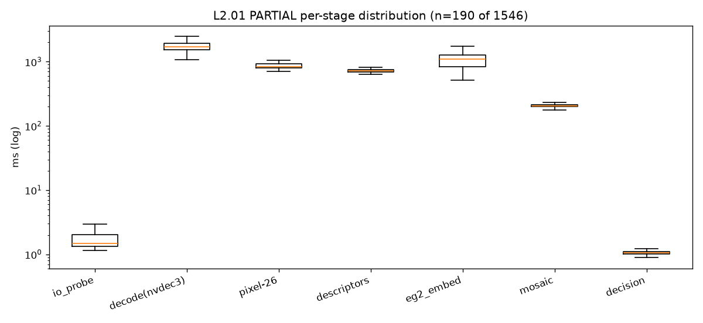

# L2 PARTIAL baseline (190 windows of 1,546) — outcomes + atomic per-stage latency

**Registry id:** L2.01 · **Owner:** l2-latency · **Device:** A40 · **Branch:** `m/latency-full` · **git_sha:** `ae2df45`

**Sampling:** `OMP_NUM_THREADS=1`, `--workers 4` · **PARTIAL: 190 of 1,546 windows** (2 clips, 2 factories)

> **This run was STOPPED and superseded.** The baseline full-corpus run was cancelled by the orchestrator in favour of the optimized full-potential run (L3) and the zero-copy run (L4), which take the pod exclusively. The numbers below are only the windows already written to `windows.jsonl.partial`: a **contiguous prefix** of the manifest (the first 2 clips), **not** a stratified sample. Do not read the verdict shares as corpus-wide.

## What this is

Runs the **repo's E8.01 pipeline** (`eval/exp_rescore/run_e8.py` — one NVDEC + `scale_cuda` three-branch pass per window, pixel-26 + EG2 (2 fps) + E4.01 descriptors → profile router; `jadal/ensemble/scorer.py` frozen two-view logistic ensemble → verdict + content-hashed receipt) over the manifest windows with `time.perf_counter` around every stage. It is **not** a new benchmark re-implementation: `run_full.py` imports the repo modules and only inserts timing. One JSONL row per window is in `eval/results/exp_latency_full/windows.jsonl` (partial: `windows.jsonl.partial`).

> These 1,546 Egocentric-10K windows have NO human labels: label_source is 'none' and every accept/reject/review verdict here is DESCRIPTIVE, not accuracy. IndEgo-trained models did not transfer out-of-domain (0.4-0.53 AUROC on the 60 human-labelled Egocentric-10K windows, n_bad=9), so the accept/reject share below is NOT a quality measure.

## Outcomes

- **Windows processed:** 190 / 190 · **failures:** 0 · **clips:** 2
- **Verdict reproduction vs E8.01:** EXACT on all compared windows (190 windows compared, 0 mismatches, 190/190 `features_digest` identical).

| verdict | L2 n | L2 share | E8.01 n (same windows) | E8.01 share |
|---|---|---|---|---|
| accept | 27 | 14.21% | 27 | 14.21% |
| reject | 2 | 1.05% | 2 | 1.05% |
| review | 161 | 84.74% | 161 | 84.74% |

Profile distribution: `{'factory_1080p30': 190}`. Verdicts are **descriptive** (no human labels); the accept/reject share is not a quality measure.

## Time (measured)

- **Wall:** 237.3 s (3.96 min) · **0.8006 windows/s** (48.0/min) · 4 workers, `OMP_NUM_THREADS=1`
- **Footage / wall-hour:** 8.006 h of footage per wall-hour (0.528 h processed of the 4.404 h corpus)
- Per window: mean 4854.8 ms, p50 4591.9 ms, p95 6310.8 ms

### Per-stage latency (ms / 10-s window)

| stage | p50 | p95 | p99 | mean | share |
|---|---|---|---|---|---|
| io_probe | 1.48 | 3.15 | 5.15 | 1.8 | 0.04% |
| decode(nvdec3) | 1714.89 | 2492.12 | 3131.65 | 1780.43 | 36.67% |
| pixel-26 | 838.35 | 1187.27 | 1668.57 | 893.86 | 18.41% |
| descriptors | 719.98 | 863.41 | 1052.97 | 734.61 | 15.13% |
| eg2_embed | 1101.45 | 1536.41 | 9622.97 | 1235.23 | 25.44% |
| mosaic | 203.3 | 266.07 | 324.24 | 207.82 | 4.28% |
| decision | 1.06 | 1.2 | 1.42 | 1.05 | 0.02% |
| write | — | — | — | — | — |

`write` is **not captured**: the parent times the JSONL flush *after* appending to the partial file, and the run was stopped before any row carried it. It is a sub-millisecond append.

**Bottleneck:** `decode(nvdec3)` (1780.43 ms mean, 36.67% of the per-window total). Ranked shares: decode(nvdec3) 36.67%, eg2_embed 25.44%, pixel-26 18.41%, descriptors 15.13%, mosaic 4.28%, io_probe 0.04%, decision 0.02%.

The EG2 `p99` (9.6 s) is the 4 first-window warmups (one per worker) loading/priming the model; the `p50` (1.10 s) is the steady-state cost. Decode is the largest steady-state stage, matching E8.01 (decode 2354 ms > EG2 1196 ms mean).

### CPU decode vs NVDEC

- Comparison on the first window of each processed clip (n=2): CPU ffmpeg/swscale p50 4070.56 ms vs explicit NVDEC `-c:v hevc_cuvid` p50 983.36 ms → **4.139x** faster on GPU.
- Pipeline decode (E8.01 three-branch NVDEC pass) p50 1714.89 ms. CPU and cuvid arms decode ONE 160x90 branch; the pipeline decode is the E8.01 three-branch NVDEC pass, not like-for-like

### GPU / cores

- EG2 per-window torch VRAM peak: p50 2146.84 MiB.
- Cores: 96 nproc, 4 workers, OMP_NUM_THREADS=1. nvidia-smi per-stage attribution unavailable in the partial (run_meta not written); EG2 torch VRAM peak per window is shown

## Adopted-policy variant

- the every-2nd + 4 s early-exit probe runs after the pool; the run was stopped before it, so it is not captured in the partial.

## Per-clip throughput

| clip | factory | n win | mean total ms | p95 ms | mean decode ms | mean eg2 ms | serial s |
|---|---|---|---|---|---|---|---|
| factory001_worker006_00008.mp4 | factory_001 | 119 | 4883.1 | 5824.0 | 1738.0 | 1346.5 | 581.1 |
| factory003_worker004_00003.mp4 | factory_003 | 71 | 4807.4 | 6569.6 | 1851.5 | 1048.8 | 341.3 |

## Figures

## Reproduction & caveats

- Verdicts/`score`/`features_digest` use the same code path as E8.01 and are **identical on every compared window**; only `latency_ms` carries more stages, so `receipt_sha256` differs from E8.01 (expected).
- The EG2 model dir is patched **in memory** to the pod cache: a post-merge commit reverted `configs/ensemble_v1.json` to the laptop path; the head numbers are unchanged (`run_e8.load_config_checked`).
- Contention caveat: pod load ~10-13/96 from peer opencode sessions; 4 single-threaded workers; GPU bursty
- **Stopped run:** superseded by L3 (optimized full-potential) and L4 (zero-copy); see `partial_note`.
