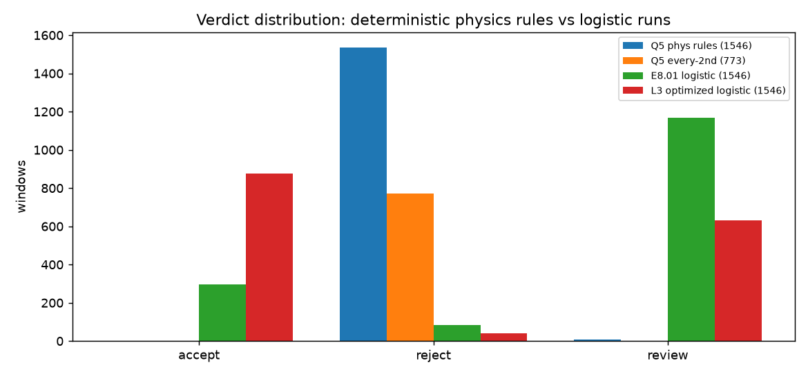
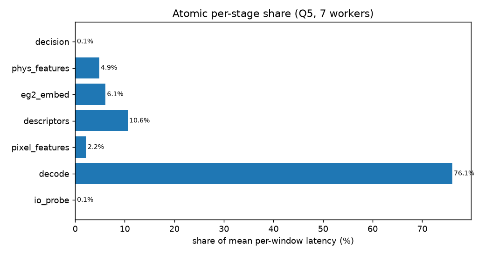
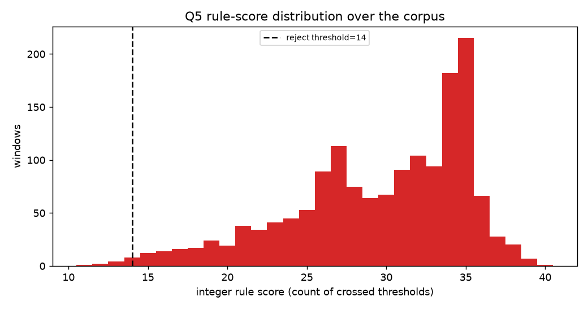
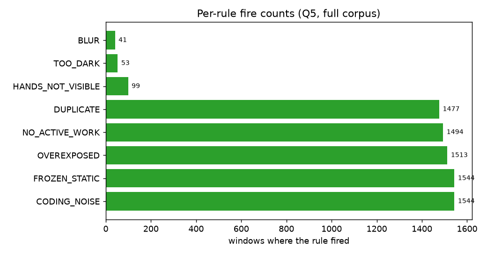

# exp_phys_full — Q5.01 Deterministic physics rules, full corpus

**Branch:** `m/phys-full` · **Result:** `eval/results/exp_phys_full/Q5.01.json` · **Rows:** `eval/results/exp_phys_full/windows.jsonl`

> These 1,546 Egocentric-10K windows have NO human labels: label_source is 'none' and every accept/reject/review verdict here is DESCRIPTIVE, not accuracy. The Q1 rule thresholds were derived on 7 IndEgo gold clips; applying them out-of-domain is a determinism transfer test, not a quality measure.

## What ran

The L3 latency runner (`eval/exp_latency_fast/run_fast.py`) copied onto this branch with the **decision stage swapped** to Q1's deterministic physics rule list (`eval/exp_phys/phys_rules.py` + frozen `rule_table.json`, reject_threshold=14, rule_table_sha256=2bc865339d74c43361a90ec7157a82d0aae84ec1753ae2bae1dd0fd847c278e1). Decode, pixel-26 features, E4.01 descriptors, the router and the EG2 mean embedding are unchanged; an extra atomic stage (`phys_features`) computes the 16 physics features the rules consume. Adopted optimizations: pixel 3.33 fps, EG2 1 fps, 4 s early exit, mosaic off; `--workers 7`, `JADAL_GPU_SLOTS=6`, `OMP_NUM_THREADS=1`, A40 NVDEC.

## Corpus

1544 windows / 58 clips / 4.404 h; 2 decode errors.

- `s_c34f52c65747` (factory_003/worker_004/factory003_worker004_00003.mp4): RuntimeError: ffmpeg rc=218: t one of its streams received no packets.
[out#1/rawvideo @ 0x557d6bdbb940] Nothing was written into output fil

- `s_694a333af837` (factory_003/worker_004/factory003_worker004_00003.mp4): RuntimeError: ffmpeg rc=187:  for codec hevc.
[vist#0:0/hevc @ 0x63f156053f80] Hardware device setup failed for decoder: Generic error in an

## Verdict distribution (deterministic rules)

| verdict | windows | share |
|---|---|---|
| accept | 0 | 0.0% |
| reject | 1537 | 99.55% |
| review | 7 | 0.45% |

Every-2nd adopted policy (772 windows): accept 0 · reject 771 · review 1.

## Throughput

- **Total wall:** 1066.78 s (17.78 min)
- **Windows/s:** 1.4473
- **Footage-h / wall-hour:** 14.862 (processed 14.473)
- **Per window:** mean 4503.6 ms · p50 4283.1 ms · p95 6319.1 ms

## Per-stage latency (ms)

| stage | p50 | p95 | mean | share |
|---|---|---|---|---|
| io_probe | 1.9 | 4.8 | 3.3 | 0.07% |
| decode | 3298.8 | 4920.1 | 3425.8 | 76.07% |
| pixel_features | 89.3 | 187.3 | 99.4 | 2.21% |
| descriptors | 445.7 | 809.4 | 477.6 | 10.6% |
| eg2_embed | 200.1 | 332.1 | 275.6 | 6.12% |
| phys_features | 201.1 | 323.5 | 219.0 | 4.86% |
| decision | 2.0 | 3.4 | 2.6 | 0.06% |
| total | 4283.1 | 6319.1 | 4503.6 | 100.0% |

## Determinism

Scored the first 10 windows twice (after the pool): **receipt byte-identical = True**, **features_digest identical = True**. `receipt_sha256` hashes the contract line **excluding** `latency_ms` (timing is not deterministic).

## Comparison to the logistic runs

- E8.01 (full, unoptimized): {'accept': 296, 'reject': 83, 'review': 1167} ({'accept': 19.15, 'reject': 5.37, 'review': 75.49})
- L3 (optimized logistic): {'accept': 876, 'reject': 40, 'review': 630} ({'accept': 56.66, 'reject': 2.59, 'review': 40.75})
- L2 (partial baseline): {'accept': 27, 'reject': 2, 'review': 161}

- Verdict agreement vs E8.01 per-window: 5.76% (n=1544, kappa=0.0008).
- Verdict agreement vs L3 per-window: 2.85% (n=1544, kappa=0.0009).
- Binary reject-vs-not vs E8.01: {'n': 1544, 'reject_agreement_pct': 5.83, 'both_reject': 83, 'e8_reject_only': 0, 'q5_reject_only': 1454, 'neither': 7}.

Q1 fixed IndEgo-quantile thresholds applied to out-of-domain Egocentric-10K: the disagreement with the trained logistic ensemble is the determinism/OOD trade-off, quantified above.

## Per-rule firing (full corpus)

| rule | windows | share |
|---|---|---|
| CODING_NOISE | 1544 | 100.0% |
| FROZEN_STATIC | 1544 | 100.0% |
| OVEREXPOSED | 1513 | 97.99% |
| NO_ACTIVE_WORK | 1494 | 96.76% |
| DUPLICATE | 1477 | 95.66% |
| HANDS_NOT_VISIBLE | 99 | 6.41% |
| TOO_DARK | 53 | 3.43% |
| BLUR | 41 | 2.66% |
## Interpretation (determinism / OOD trade-off)

The deterministic rules **do not transfer** to the Egocentric-10K corpus: 99.55% of windows are REJECT (score p50 31 vs the reject_threshold 14), and four weak/quality rules fire on 95-100% of windows (CODING_NOISE, FROZEN_STATIC 100%; OVEREXPOSED 98%; NO_ACTIVE_WORK 97%; DUPLICATE 96%). Per-window agreement with E8.01 is 5.76% (kappa 0.0008) and with L3 2.85%. This is the price of a fully deterministic, label-free threshold table trained on 7 IndEgo clips: the physics quantiles are regime-specific, so an out-of-domain deployment needs either per-regime re-quantiling or a label-free normalisation. In-domain (Q1) the same model matches the logistic baseline (AUROC 0.822 vs 0.802).

The decision stage itself costs 2.6 ms mean (0.06% of the window) versus 1.05 ms for the logistic decision (L2): the rules are free; the window is **feature-bound** (decode 76.1%).

## Figures

