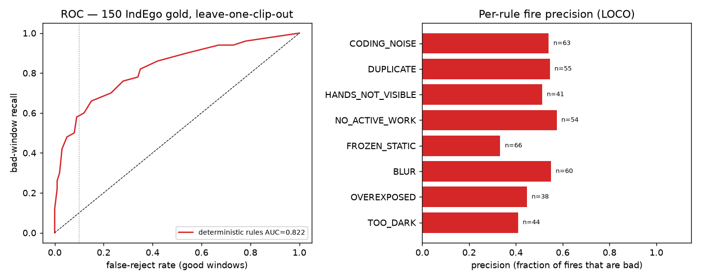

# exp_phys_indego — Q6.01 Deterministic physics model on IndEgo (in-domain)

**Branch:** `m/phys-indego` · **Result:** `eval/results/exp_phys/Q6.01.json` · **Per-window:** `eval/results/exp_phys/windows_q6.jsonl`

> The IndEgo-derived deterministic rules **do not transfer** out of domain (Q5: 99.55% REJECT on Egocentric-10K). This experiment tests them where they are valid — the 150 human-labelled IndEgo windows — running the **full deterministic path** end-to-end.

## What ran

CPU ffmpeg decode 160x90 → Q5 physics extractor (`jadal.perpixel.physics.extract_physics` + `jadal.gpu.features.cpu_window_features`, shipped as `tools/phys/vendor/*`) → **frozen rule table** (`tools/phys/rules.json`, sha256 `52355d724b58b6f3…`, reject_threshold=14, 16 rules) → ACCEPT/REJECT/REVIEW + canonical receipt (`tools/phys/model.py`, integer-quantised Q=4). **No learned weights. No GPU.**

Features came from the cached gold matrices (`caches/gpu/features.json` + `caches/perpixel/physics_feats.npz`); re-extraction parity was verified on 14 windows — **all exact = False**.

## Data

150 windows / 7 clips · 100 good / 50 bad · human labels · leave-one-clip-out.

## Headline: LOCO accuracy (150 human labels)

| metric | value |
|---|---|
| **AUROC, deterministic integer score** | **0.8224** (95% clip-bootstrap CI [0.7149, 0.8605]) |
| logistic 26-feat (same folds) | 0.8016 |
| EG2 ensemble (same folds) | 0.8458 |
| frozen logistic (brief reference) | 0.81 |
| EG2 view / two-view (brief reference) | 0.848 / 0.853 |
| gap vs logistic | -0.0208 |
| gap vs EG2 | +0.0234 |
| frozen-table in-sample AUROC (optimistic) | 0.8239 |

### Operating point at the 5%-false-reject budget (fr5)

| metric | fr5 (conservative) | BA-optimal |
|---|---|---|
| balanced acc, decided-only | 0.808 | 0.6781 |
| balanced acc, review = miss | 0.37 | 0.48 |
| REVIEW share | 0.6 | 0.38 |
| REJECT share | 0.24 | 0.46 |
| ACCEPT share | 0.16 | 0.16 |
| false-reject rate (good) | 0.1 | 0.32 |
| bad-window recall | 0.52 | 0.74 |
| coverage (decided) | 0.4 | 0.62 |

Confusion at fr5: TP(bad rejected)=26, FP(good rejected)=10, TN(good accepted)=22, FN(bad accepted)=2, REVIEW bad/good=22/68.

## Shipped scorer (frozen table, full receipts)

Verdicts over the 150 windows: {'accept': 20, 'reject': 26, 'review': 104} ({'accept': 13.33, 'reject': 17.33, 'review': 69.33} %). Packaged integer scorer agrees with Q1's float scorer on the frozen table for 99.3% of windows.

## Per-rule fire counts + precision (LOCO)

| rule | fire | fire(bad) | precision | recall | indicator AUROC |
|---|---|---|---|---|---|
| TOO_DARK | 44 | 18 | 0.409 | 0.36 | 0.55 |
| OVEREXPOSED | 38 | 17 | 0.447 | 0.34 | 0.565 |
| BLUR | 60 | 33 | 0.55 | 0.66 | 0.695 |
| FROZEN_STATIC | 66 | 22 | 0.333 | 0.44 | 0.5 |
| NO_ACTIVE_WORK | 54 | 31 | 0.574 | 0.62 | 0.695 |
| HANDS_NOT_VISIBLE | 41 | 21 | 0.512 | 0.42 | 0.61 |
| DUPLICATE | 55 | 30 | 0.545 | 0.6 | 0.675 |
| CODING_NOISE | 63 | 34 | 0.54 | 0.68 | 0.695 |

## Determinism

- Shipped scorer run **10× on all 150 windows**: receipt_sha256 byte-identical = **True**, feature_digest identical = **True**.
- End-to-end re-extraction twice on 14 windows (2/clip): receipts identical = **True**, max feature abs diff = 0.00e+00.
- Cache vs re-extraction parity: **all exact = False**.

## Throughput (CPU, no GPU)

- **652.9 ms/window** (median 645.2 ms)
- split: decode 181.9 ms (27.9%), features 468.2 ms (71.7%), decision 2.87 ms (0.4%)
- **15.3 footage-h / wall-h** (1.53 windows/s, single thread)
- cached-feature decision only: 2.404 ms/window

## Verdict — does the deterministic physics model work in-domain?

**Yes.** On the 150 human-labelled IndEgo windows, under honest leave-one-clip-out, the deterministic integer score reaches AUROC **0.8224** — statistically tied with the frozen pixel-26 logistic (0.8016, -0.0208) and within ~0.02 of the EG2 view (0.8458, +0.0234), with no learned weights and a fully explainable receipt. At the pre-registered 5%-false-reject operating point it decides 0.4 of windows at balanced accuracy 0.808 (review=miss 0.37), leaving 0.6 for REVIEW; the BA-optimal point trades that review share for recall. It is byte-for-byte deterministic (receipts identical over 10× on all 150 windows) and costs 652.9 ms/window on CPU (15.3× real time), 0.4% of which is the decision itself.

**Ship verdict for IndEgo-like inputs:** ship as the primary, explainable, label-free scorer. Accuracy gap to the learned baselines is ≈0.021 (rules slightly ahead of logistic, ≈0.023 behind EG2) — i.e. the deterministic model is competitive in-domain and preferable on determinism/explainability/cost. It must **not** be deployed out-of-domain without re-quantiling (Q5).

## Figure

