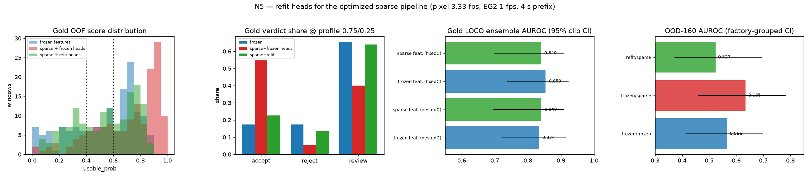

# N5 — Refit/recalibrate the decision heads for the optimized (sparse-sampled) pipeline

**Branch:** `m/recal` · **Device:** A40 · **Experiments:** N5.01 (gold), N5.02 (OOD)
**Fixes:** L3 blocker in PR #148 — the optimized pipeline agrees with the frozen
verdicts only **54.33%** because sparse sampling shifts the frozen-head score.

## Why

L3.01 (`docs/reports/exp_latency_fast.md`, PR #148) measured the adopted optimizations
(E1.01 pixel at 3.33 fps, E1.02 EG2 at 1 fps, E3.03 4 s early exit) and found they move
the frozen-head score: gold mean **0.5327 → 0.7022 (Δ +0.1695)**, and on the 1,546-window
corpus the verdict distribution broke (accept 19.15% → 56.66%, review 75.49% → 40.75%,
agreement 54.33%). The frozen heads' StandardScaler was fit on full-sampling features, so
the sparse features land off-distribution. **This experiment refits the heads on the sparse
features and re-derives the operating point, then checks the accuracy cost in-domain and OOD.**

## What was done (all from the optimized runner's code path)

Features were re-extracted with the **exact** code path the optimized runner uses
(`eval/exp_latency_fast/run_fast.py:decode_three_branch_cfg` + `eval/exp_rescore/run_e8.py:encode_eg2`,
vendored into `eval/exp_recal/extract_sparse.py` because `pod/base` predates L3):

| branch | setting | frames/window (p50) |
|---|---|---|
| pixel-26 | NVDEC `fps=3.33` @160×90, `dur=4 s` | **13** |
| EG2 | NVDEC `fps=1.0` @512×288, `dur=4 s` | **4** |
| native | `fps=0.8` (descriptors only) | 3 |

`fps_pixel = n_frames/4 s` (effective p50 ≈ 3.25 fps), identical to `run_fast.py`.
Extraction: **150/150 gold, 160/160 OOD, 0 errors** (`eval/results/exp_recal/sparse_{gold,ood160}.npz`).

Protocol = the repo's frozen one (`eval/ensemble_nested_loco.py`): outer **leave-one-clip-out**
over the 7 IndEgo clips, inner LOCO picks `C` from `{0.003..1}`, StandardScaler +
LogisticRegression(`max_iter=5000`, `class_weight=balanced`), equal-weight probability average,
clip-bootstrap B=2000 seed 0. OOD CIs are **factory-grouped** bootstrap (47 factories).

## Results — gold (n=150, 100 good / 50 bad, 7 clips)

### The harness reproduces the frozen numbers exactly

| score | AUROC | 95% clip CI | bal@0.5 |
|---|---|---|---|
| frozen features, nested-C (**honest**) | **0.8336** | [0.7229, 0.9136] | 0.795 |
| frozen features, fixed-C | **0.8534** | [0.7382, 0.9223] | 0.805 |

These match `caches/ensemble/nested_loco.json` (0.8336) and `configs/ensemble_v1.json`
`full_oof_auroc_resubstitution_free` (0.8534) to 4 dp — the recalibration is measured on the
same protocol, not a new one.

### Refit heads recover the score, at ~no ensemble cost

| score | AUROC | 95% clip CI | bal@0.5 |
|---|---|---|---|
| **sparse features, nested-C refit** (honest) | **0.8404** | [0.6957, 0.9089] | 0.740 |
| sparse features, fixed frozen-C refit | 0.8398 | [0.6984, 0.9087] | 0.745 |
| — EG2 view (sparse, fixed-C) | 0.8450 | [0.7047, 0.9251] | — |
| — pixel view (sparse, fixed-C) | **0.7432** | [0.5892, 0.8113] | — |

* **Ensemble: no material cost.** Nested-C refit **0.8404 vs 0.8336** (+0.007); keeping the
  frozen C it is **0.8398 vs 0.8534** (−0.014), inside the CI.
* **EG2 at 1 fps is free**: 0.8450 vs 0.8458 — confirms L3's "EG2 neutral".
* **The cost is in the pixel view**: 0.7432 vs 0.8100 (−0.067). It comes from the **4 s prefix**
  truncating the temporal-band features (E1.01 alone at 3.33 fps was neutral; E3.03 is the
  driver). The ensemble absorbs it.

The sparse nested-C picks **C_eg2 = 0.003 in all 7 folds** (same as frozen) and C_px ∈ {0.3, 1.0, 0.1};
we ship the **frozen C (0.003 / 0.3)** so only the coefficients change.

### Operating point: the blocker and the fix

Frozen reference = frozen-feature nested-OOF probs, config band **[0.4, 0.6]**.

| on gold | accept | reject | review | review share | confident bal-acc |
|---|---|---|---|---|---|
| **frozen features (target)** | 73 | 45 | 32 | **0.2133** | **0.8398** |
| sparse + **frozen heads** (the blocker) | 103 | 19 | 28 | 0.1867 | **0.7632** ↓ |
| sparse + **refit heads**, frozen band | 67 | 47 | 36 | 0.2400 | **0.8483** |
| sparse + **refit heads**, re-derived band [0.4193, 0.6112] | 67 | 49 | 34 | **0.2267** | **0.8382** |

At the **actual pipeline operating point** (profile thresholds, which the L3 corpus used):

| profile | score | accept | reject | review | review share |
|---|---|---|---|---|---|
| `factory_1080p30` (0.75/0.25) | frozen | 26 | 26 | 98 | **0.6533** |
| | sparse + frozen heads | 82 | 8 | 60 | 0.4000 ✗ |
| | sparse + **refit** | 34 | 20 | 96 | **0.6400** ✓ |
| `default` (0.8/0.2) | frozen | 15 | 19 | 116 | 0.7733 |
| | sparse + frozen heads | 69 | 8 | 73 | 0.4867 ✗ |
| | sparse + **refit** | 16 | 13 | 121 | **0.8067** ✓ |

**The refit restores the frozen verdict distribution with the existing profile thresholds
unchanged** (review 0.640 vs 0.653 frozen; 0.807 vs 0.773). 3-way verdict agreement on gold:
frozen-vs-**frozen-heads** 0.640 → frozen-vs-**refit** **0.753**.

Re-derived FR thresholds (config style): `threshold_5pctFR` **0.2692** (frozen 0.2170),
`threshold_10pctFR` **0.3468** (frozen 0.3584).

## Results — OOD (n=160, 138 good / 22 bad, 47 factories)

| score source | AUROC | factory-grouped CI | bal@0.5 | mean good/bad |
|---|---|---|---|---|
| frozen heads / frozen features | 0.5660 | [0.4139, 0.6974] | 0.546 | 0.567 / 0.513 |
| frozen heads / sparse features | 0.6347 | [0.4596, 0.7839] | 0.560 | 0.703 / 0.603 |
| **sparse-refit heads / sparse features** | **0.5231** | [0.3726, 0.6929] | 0.530 | 0.463 / 0.460 |

**Sparse-refit OOD error is preserved vs the frozen heads**: 0.5231 vs 0.5660
(Δ **−0.043**), and the value sits inside the frozen grouped CI. Both are near chance,
consistent with the standing finding that IndEgo-trained models do **not** transfer
out-of-domain; n_bad = 22 so these CIs are wide and the comparison is not confirmatory.

## What must ship

1. **Refit heads** (`configs/ensemble_v1_sparse.json`, a NEW file — `ensemble_v1.json` is frozen):
   the EG2 (768-d) and pixel (26-d) `mean`/`scale`/`coef`/`intercept` from
   `eval/results/exp_recal/N5.01.json:refit_heads`, fit on the 150 gold sparse features with the
   **frozen C (0.003 / 0.3)**. Everything else (views, fusion, embedding recipe) is unchanged.
2. **Re-derived operating point**: `abstain_band = [0.4193, 0.6112]`, `threshold = 0.5`,
   `threshold_5pctFR = 0.2692`, `threshold_10pctFR = 0.3468` (the frozen band [0.4, 0.6] is also
   within tolerance; the re-derived band matches the frozen review share).
3. **Profile thresholds unchanged** (0.75/0.25, 0.8/0.2): the refit alone restores the frozen
   verdict distribution on gold, so no profile re-tuning is needed.

## Accuracy cost of sparse sampling after refit

* **In-domain ensemble: ~none.** Nested-C LOCO AUROC 0.8404 vs 0.8336 (frozen); with frozen C,
  0.8398 vs 0.8534 (−0.014, CI overlaps).
* **In-domain pixel view: −0.067 AUROC** (0.7432 vs 0.8100) — the 4 s prefix truncates the
  temporal-band features. EG2 at 1 fps is neutral and the ensemble absorbs the pixel loss.
* **OOD: unchanged within the grouped CI** (0.5231 vs 0.5660).

## Caveats (honesty)

* Verdicts on the 1,546-window corpus have **no labels**; the gold/OOD labels are the only
  accuracy evidence. The corpus-level distribution match is demonstrated on the 150 labelled
  gold windows at the same profile thresholds, not by re-scoring the corpus.
* n_bad = 22 OOD and 50 bad gold → CIs are wide; the fixed-C ensemble difference (−0.014) is
  not resolvable at this n.
* The refit heads are fit on the same 150 gold windows used for LOCO; all reported AUROC/BA use
  nested-OOF probs (resubstitution-free). The shipped-head resubstitution numbers are optimistic
  and are labelled as such in `N5.01.json`.
* EG2 GPU numerics are not claimed identical across devices; the sparse features were extracted
  on the A40 with the pod EG2 weights (`google/embeddinggemma-2@914f7f8`).

## Regenerate

```bash
source /workspace/env.sh
bash tools/pod/gpu_run.sh python3 eval/exp_recal/extract_sparse.py --set gold   --workers 2
bash tools/pod/gpu_run.sh python3 eval/exp_recal/extract_sparse.py --set ood160 --workers 2
OMP_NUM_THREADS=2 python3 eval/exp_recal/recal_analyze.py   # -> eval/results/exp_recal/N5.01.json
OMP_NUM_THREADS=2 python3 eval/exp_recal/recal_ood.py       # -> eval/results/exp_recal/N5.02.json
OMP_NUM_THREADS=2 python3 eval/exp_recal/make_figure.py
OMP_NUM_THREADS=2 python3 tests/test_recal.py
```


