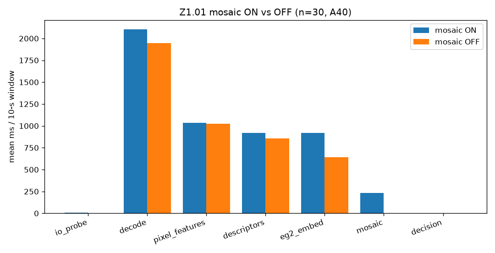
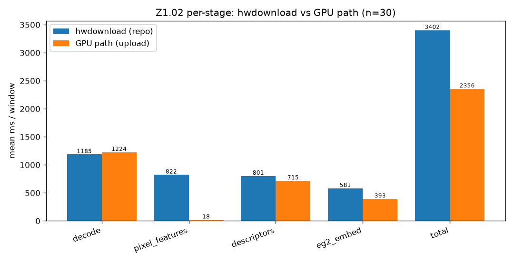
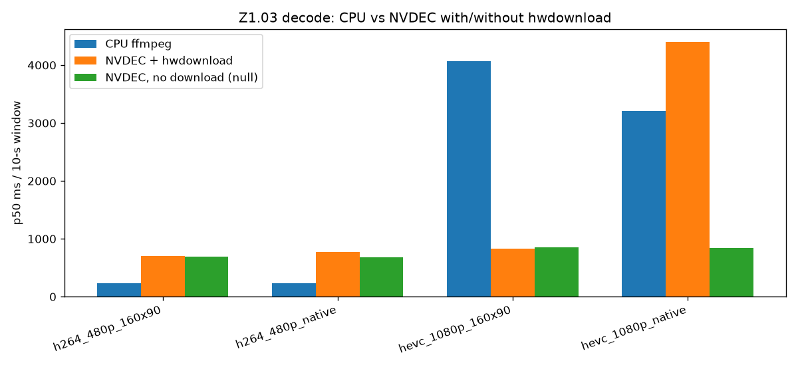
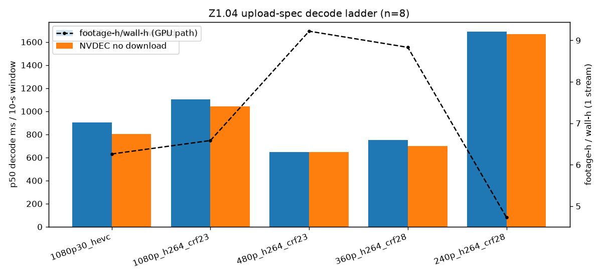

# Z1 — mosaic delta + zero-copy GPU path + decode verdict

**Device:** A40 · **Branch:** `m/zerocopy` · **Runner:** `eval/exp_zerocopy/run_zerocopy.py`

> Mosaic is an evidence artefact, not a model input. Zero-copy: the repo decode is an out-of-process ffmpeg pipe (host memory only), so true VRAM-residency needs an in-process NVDEC binding; wherever that was not possible it is reported, not faked. All numbers carry n.

## Z1.01 Mosaic ON vs OFF

Same 30-window sample (spread over 30 factories), full repo pipeline run twice; only the mosaic build differs.

- Mosaic stage (the only difference between the two passes): mean 233.22 ms, p50 227.46 ms per window → **clean wall delta 233.22 ms/window**.
- Two independent passes cross-check: ON mean 5222.47 ms vs OFF mean 4475.84 ms → delta 746.62 ± 1730.65 ms (noisy: run-to-run variance / pod contention; the mosaic build is the only code difference).
- Verdicts identical: **True** (disagreements 0, `features_digest` mismatches 0, score mismatches 0).



## Z1.02 Zero-copy GPU path vs hwdownload

- Mode: `upload` (torchcodec available: True).
- **Blockers:** `{"torchcodec_runtime": "RuntimeError: Unsupported device: cuda"}`

**Why true zero-copy is blocked (attempted, not faked):** the repo's decode is an out-of-process ffmpeg whose only output is a host-memory pipe (`-f rawvideo ... pipe:1`); ffmpeg has no muxer that writes CUDA device memory, so frames cannot stay VRAM-resident across that boundary. The only in-process NVDEC binding that installs here, `torchcodec`, was tried at 0.6/0.8/0.10/0.12/0.17: 0.6 imports but rejects `device='cuda'` (`Unsupported device: cuda`); 0.10/0.12 fail to load (bundled FFmpeg soname); 0.17 needs a CUDA-13 runtime (`libnvrtc.so.13`, `libcudart.so.13`) that is not present (driver 580 is CUDA 13 but only the CUDA-12.8 toolkit is installed, and the PyPI `*-cu13` packages are empty placeholders). `PyNvVideoCodec`, `cv2.cudacodec`, `decord`, `av` and `cupy` are all absent. `torchcodec` was installed into the pod env only to probe this (it is **not** a repo dependency). The measured GPU path is therefore the **partial** upload path (hwdownload, then one small upload of the pix+EG2 frames); the compute stages are genuinely device-resident, the decode hop is not.


| stage | hwdownload mean ms | GPU mean ms | speedup |
|---|---|---|---|
| decode | 1185.3 | 1224.38 | 0.968x |
| pixel_features | 821.57 | 18.46 | 44.516x |
| descriptors | 800.97 | 715.41 | 1.12x |
| eg2_embed | 581.26 | 393.09 | 1.479x |
| total | 3402.05 | 2356.13 | 1.444x |

- EG2 embedding cosine vs the repo `encode()` path: mean 1.0 (p50 1.0).
- Verdict agreement: 29/30 (0.967).
- PCIe bytes/window: base 80421120 vs GPU 93381120 → **saved -12960000 B/window** (-12.96 MB). The partial path is *negative* here: it still hwdownloads (same as the repo) and then re-uploads the pix+EG2 frames, so it adds ~13 MB/window. Only true in-process zero-copy would save the ~80 MB/window round trip (pix+EG2+native download + EG2 upload).
- Largest pixel-feature |Δ|: `radial_slope` 0.17597, `dup_hash_mean` 0.13611, `pca_top1_share` 0.02302, `illum_r` 0.00669, `illum_b` 0.00418, `illum_g` 0.00342.



## Z1.03 Decode verdict (NVDEC vs CPU)

| arm | CPU p50 ms | NVDEC+hwdownload p50 ms | NVDEC no-download p50 ms | hwdownload cost |
|---|---|---|---|---|
| h264_480p_160x90 | 227.7 | 705.2 | 696.0 | 9.2 |
| h264_480p_native | 233.0 | 771.7 | 680.7 | 91.0 |
| hevc_1080p_160x90 | 4067.1 | 832.0 | 847.3 | -15.3 |
| hevc_1080p_native | 3209.4 | 4403.4 | 839.3 | 3564.1 |



## Upload-compressed input (deployment may choose the upload spec)

If upload-side encoding is allowed, the codec/resolution/quality is a free variable. Ladder on the same 8-window sample (feature/EG2 costs are resolution-invariant: the pipeline always works at 160x90 / 512x288, so only decode is spec-dependent). Upload segments were transcoded with **NVENC** (`-cq`, ~CRF) to stay off the contended pod CPU; the reference stages are from the 30-window zero-copy run.

| spec | bitrate kbps | B/frame | decode NVDEC p50 ms | decode NVDEC min ms | decode CPU p50 ms | best decode | total base ms | total GPU ms | total best ms | footage-h/wall-h (best) |
|---|---|---|---|---|---|---|---|---|---|---|
| 1080p30_hevc | 4694.9 | 19562.1 | 904.0 | 899.9 | 3637.1 | nvdec | 2589.0 | 1597.7 | 1315.5 | 7.602 |
| 1080p_h264_crf23 | 12891.8 | 53715.8 | 1104.5 | 918.8 | 3076.6 | nvdec | 2510.2 | 1518.9 | 1516.0 | 6.596 |
| 480p_h264_crf23 | 3190.9 | 13295.3 | 648.3 | 622.4 | 744.7 | nvdec | 2075.7 | 1084.4 | 1059.8 | 9.436 |
| 360p_h264_crf28 | 1067.8 | 4449.1 | 749.3 | 625.3 | 300.0 | cpu | 2123.6 | 1132.3 | 711.5 | 14.055 |
| 240p_h264_crf28 | 526.6 | 2194.4 | 1689.5 | 745.2 | 779.8 | cpu | 3107.1 | 2115.8 | 1191.3 | 8.394 |

- **Recommended combo:** `360p_h264_crf28` upload × **cpu** decode × GPU pixel-26 + GPU EG2. X1 measured 360p@CRF28 ≈ 40% of the bytes with ΔAUROC < 0.02; here 360p and 480p decode within noise, but at 360p the CPU decoder wins (300.0 ms vs NVDEC 749.3 ms), so the best combo is 360p + CPU decode + GPU feature/embed. 240p was **not** accuracy-validated.
- **NVDEC-vs-CPU flip:** NVDEC wins at 1080p (HEVC 904.0 ms vs CPU 3637.1 ms); at 480p it is a wash (NVDEC 648.3 ms vs CPU 744.7 ms); at 360p CPU wins (300.0 ms vs NVDEC 749.3 ms). So the flip point is between 480p and 360p. The 240p row is contended (p50 inflated; min 745.2 ms).
- **Zero-copy vs not:** `total base` = NVDEC+hwdownload decode + CPU pixel-26 + `encode()` EG2; `total GPU` = same decode + GPU pixel-26 (18 ms) + GPU EG2 (393 ms). The GPU path is ~1.9× faster and the gap is dominated by the pixel-26 stage (CPU 822 ms → GPU 18 ms). True zero-copy would additionally drop the (here small, 160x90) hwdownload; the large native-frame download is the descriptor branch, which also shrinks with the spec.
- **End-to-end extrapolation to the full corpus** (1,546 windows / 4.404 h) for the recommended combo `360p_h264_crf28` × cpu decode × GPU feature/embed (711.5 ms/window): **18.3 min on 1 worker** (14.413 footage-h/wall-h), ~4.6 min at 4 workers ideal (57.653 footage-h/wall-h). best combo = spec x faster decode path x GPU feature/embed; ideal linear worker scaling (real scaling is GPU/EG2-bound, measured at 4 workers in L2.01).



## Reproduction

```bash
source /workspace/env.sh
export OMP_NUM_THREADS=2 JADAL_GPU_SLOTS=4
bash tools/pod/gpu_run.sh python3 eval/exp_zerocopy/run_zerocopy.py --sample-n 30
bash tools/pod/gpu_run.sh python3 eval/exp_zerocopy/run_upload_specs.py --sample-n 8 --reps 2 --encoder nvenc
python3 eval/exp_zerocopy/analyze_zerocopy.py
```

Verdicts are descriptive (the corpus is unlabelled). n=30 windows, one per factory; per-stage timings are wall-clock on a shared A40.

