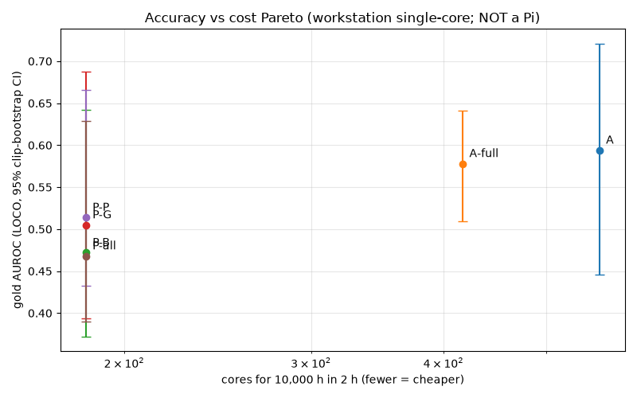

# Spectral study — harness-scored comparison

_Generated 2026-10-10T11:32:15Z by eval/spectral/score.py. Every number below comes from eval/results/spectral/summary.json._

## Question

Does per-pixel frequency/temporal-spectral analysis of RGB video (arm B), a bounded hyperspectral check (arm C), a generic VLM (arm D), or the EmbeddingGemma-2 head (arm E) beat the current OpenCV+MediaPipe L0 signals (arm A) at (1) near-duplicate detection and (2) deciding whether a 10-s segment is USABLE work footage — within a 10,000 h in 2–3 h throughput budget, whole-video single-pass? Sampling 4–8 frames per segment is NOT acceptable as the main method.

## Data & protocol

- HUMAN GOLD (live IndEgo labels, snapshot 2026-10-10T10:53:24.018553+00:00, sha256 43ab44e52eaa…, n_good=100, n_bad=50). CV: leave-one-clip-out; AUROC with clip-level bootstrap CI (B=1000). A CI spanning 0.5 means 'no evidence'. Awign data differs: nothing here is evidence on Awign footage.

- SYNTHETIC (by construction, label says nothing about activity): good-labelled segments + 9 degradations; sensitivity at 5% FAR threshold set on gold-good scores.

- DUPLICATES (by construction): threshold on held-out half 1, P/R/F1 on half 2, per method and per perturbation. Horizontal-flip excluded (NOT a duplicate).

## Results per task

| arm | gold AUROC (95% CI) | bal.acc | synth sens. (median over degs) | dups F1 | status |
|---|---|---|---|---|---|
| A | 0.594 (0.446–0.721) | 0.545 | 0.0 | 0.865 | RUN |
| A-full | 0.578 (0.509–0.641) | 0.57 | 0.0 | — | RUN |
| E | 0.496 (0.335–0.639) | 0.505 | 0.83 | 0.909 | RUN |
| B | — | — | — | — | NOT RUN |
| C | — | — | — | — | NOT RUN |
| D | — | — | — | — | NOT RUN |
| B-T0 | 0.43 (0.359–0.683) | 0.448 | 0.67 | — | RUN PARTIAL |
| B-T1 | 0.481 (0.41–0.667) | 0.448 | 1.0 | — | RUN PARTIAL |
| B-T1-150 | 0.474 (0.371–0.643) | 0.465 | 0.67 | — | RUN |
| D-SmolVLM2-2.2B-Instruct | 0.59 (0.375–0.7) | 0.509 | — | — | STOPPED PARTIAL |
| P-B | 0.472 (0.372–0.642) | 0.485 | 0.5 | — | RUN |
| P-G | 0.505 (0.394–0.688) | 0.53 | 0.17 | — | RUN |
| P-P | 0.514 (0.433–0.666) | 0.515 | 0.83 | — | RUN |
| P-all | 0.468 (0.39–0.629) | 0.505 | 0.83 | — | RUN |

### Gold detail (per arm, LOCO folds)

**A** n=150 (good=100, bad=50, clips=7): `{"head": {"auroc": 0.594, "auroc_ci95": [0.446, 0.721], "n_boot": 1000, "n_scored": 150, "balanced_accuracy": 0.545, "folds": [{"test_clip": "desk", "n_test": 29, "train_threshold": 0.6495}, {"test_clip": "ecu_full", "n_test": 48, "train_threshold": 0.575}, {"test_clip": "ecu_late", "n_test": 14, "train_threshold": 0.6634}, {"test_clip": "logistics4", "n_test": 17, "train_threshold": 0.7882}, {"test_clip": "organise", "n_test": 19, "train_threshold": 0.6469}, {"test_clip": "pallet", "n_test": 17, "train_threshold": 0.7293}, {"test_clip": "pallet2", "n_test": 6, "train_threshold": 0.6917}]}}`

**A-full** n=150 (good=100, bad=50, clips=7): `{"head": {"auroc": 0.578, "auroc_ci95": [0.509, 0.641], "n_boot": 1000, "n_scored": 150, "balanced_accuracy": 0.57, "folds": [{"test_clip": "desk", "n_test": 29, "train_threshold": 0.6538}, {"test_clip": "ecu_full", "n_test": 48, "train_threshold": 0.56}, {"test_clip": "ecu_late", "n_test": 14, "train_threshold": 0.5615}, {"test_clip": "logistics4", "n_test": 17, "train_threshold": 0.5713}, {"test_clip": "organise", "n_test": 19, "train_threshold": 0.7966}, {"test_clip": "pallet", "n_test": 17, "train_threshold": 0.7372}, {"test_clip": "pallet2", "n_test": 6, "train_threshold": 0.6526}]}}`

**E** n=150 (good=100, bad=50, clips=7): `{"head": {"auroc": 0.496, "auroc_ci95": [0.335, 0.639], "n_boot": 1000, "n_scored": 150, "balanced_accuracy": 0.505, "folds": [{"test_clip": "desk", "n_test": 29, "train_threshold": 0.9591}, {"test_clip": "ecu_full", "n_test": 48, "train_threshold": 0.9334}, {"test_clip": "ecu_late", "n_test": 14, "train_threshold": 0.9457}, {"test_clip": "logistics4", "n_test": 17, "train_threshold": 0.9425}, {"test_clip": "organise", "n_test": 19, "train_threshold": 0.9392}, {"test_clip": "pallet", "n_test": 17, "train_threshold": 0.945}, {"test_clip": "pallet2", "n_test": 6, "train_threshold": 0.9437}]}}`

**B-T0** n=79 (good=65, bad=14, clips=3): `{"head": {"auroc": 0.43, "auroc_ci95": [0.359, 0.683], "n_boot": 1000, "n_scored": 79, "balanced_accuracy": 0.448, "folds": [{"test_clip": "desk", "n_test": 17, "train_threshold": 0.6659}, {"test_clip": "ecu_full", "n_test": 48, "train_threshold": 0.5208}, {"test_clip": "ecu_late", "n_test": 14, "train_threshold": 0.5973}]}, "as_is": {"auroc": 0.637, "auroc_ci95": [0.467, 0.693], "n_boot": 1000, "n_scored": 79}, "score_logistic": {"auroc": 0.324, "folds": [{"test_clip": "desk", "n_test": 17, "train_threshold": 0.8631}, {"test_clip": "ecu_full", "n_test": 48, "train_threshold": 0.7272}, {"test_clip": "ecu_late", "n_test": 14, "train_threshold": 0.8931}]}}`

**B-T1** n=79 (good=65, bad=14, clips=3): `{"head": {"auroc": 0.481, "auroc_ci95": [0.41, 0.667], "n_boot": 1000, "n_scored": 79, "balanced_accuracy": 0.448, "folds": [{"test_clip": "desk", "n_test": 17, "train_threshold": 0.6814}, {"test_clip": "ecu_full", "n_test": 48, "train_threshold": 0.5566}, {"test_clip": "ecu_late", "n_test": 14, "train_threshold": 0.5384}]}, "as_is": {"auroc": 0.678, "auroc_ci95": [0.5, 0.684], "n_boot": 1000, "n_scored": 79}, "score_logistic": {"auroc": 0.364, "folds": [{"test_clip": "desk", "n_test": 17, "train_threshold": 0.8584}, {"test_clip": "ecu_full", "n_test": 48, "train_threshold": 0.7265}, {"test_clip": "ecu_late", "n_test": 14, "train_threshold": 0.8926}]}}`

**B-T1-150** n=150 (good=100, bad=50, clips=7): `{"head": {"auroc": 0.474, "auroc_ci95": [0.371, 0.643], "n_boot": 1000, "n_scored": 150, "balanced_accuracy": 0.465, "folds": [{"test_clip": "desk", "n_test": 29, "train_threshold": 0.7146}, {"test_clip": "ecu_full", "n_test": 48, "train_threshold": 0.6644}, {"test_clip": "ecu_late", "n_test": 14, "train_threshold": 0.7555}, {"test_clip": "logistics4", "n_test": 17, "train_threshold": 0.675}, {"test_clip": "organise", "n_test": 19, "train_threshold": 0.7099}, {"test_clip": "pallet", "n_test": 17, "train_threshold": 0.6283}, {"test_clip": "pallet2", "n_test": 6, "train_threshold": 0.7586}]}, "as_is": {"auroc": 0.678, "auroc_ci95": [0.5, 0.684], "n_boot": 1000, "n_scored": 79}, "score_logistic": {"auroc": 0.364, "folds": [{"test_clip": "desk", "n_test": 17, "train_threshold": 0.8584}, {"test_clip": "ecu_full", "n_test": 48, "train_threshold": 0.7265}, {"test_clip": "ecu_late", "n_test": 14, "train_threshold": 0.8926}]}}`

**D-SmolVLM2-2.2B-Instruct** n=79 (good=65, bad=14, clips=3): `{"head": {"auroc": 0.59, "auroc_ci95": [0.375, 0.7], "n_boot": 1000, "n_scored": 79, "balanced_accuracy": 0.509, "folds": [{"test_clip": "desk", "n_test": 17, "train_threshold": 0.8569}, {"test_clip": "ecu_full", "n_test": 48, "train_threshold": 0.7407}, {"test_clip": "ecu_late", "n_test": 14, "train_threshold": 0.8416}]}, "as_is": {"auroc": 0.765, "auroc_ci95": [0.517, 0.972], "n_boot": 1000, "n_scored": 79}, "score_logistic": {"auroc": 0.569, "folds": [{"test_clip": "desk", "n_test": 17, "train_threshold": 0.7845}, {"test_clip": "ecu_full", "n_test": 48, "train_threshold": 0.6916}, {"test_clip": "ecu_late", "n_test": 14, "train_threshold": 0.7881}]}}`

**P-B** n=150 (good=100, bad=50, clips=7): `{"head": {"auroc": 0.472, "auroc_ci95": [0.372, 0.642], "n_boot": 1000, "n_scored": 150, "balanced_accuracy": 0.485, "folds": [{"test_clip": "desk", "n_test": 29, "train_threshold": 0.7211}, {"test_clip": "ecu_full", "n_test": 48, "train_threshold": 0.6645}, {"test_clip": "ecu_late", "n_test": 14, "train_threshold": 0.754}, {"test_clip": "logistics4", "n_test": 17, "train_threshold": 0.6736}, {"test_clip": "organise", "n_test": 19, "train_threshold": 0.7977}, {"test_clip": "pallet", "n_test": 17, "train_threshold": 0.6286}, {"test_clip": "pallet2", "n_test": 6, "train_threshold": 0.7571}]}}`

**P-G** n=150 (good=100, bad=50, clips=7): `{"head": {"auroc": 0.505, "auroc_ci95": [0.394, 0.688], "n_boot": 1000, "n_scored": 150, "balanced_accuracy": 0.53, "folds": [{"test_clip": "desk", "n_test": 29, "train_threshold": 0.6692}, {"test_clip": "ecu_full", "n_test": 48, "train_threshold": 0.4229}, {"test_clip": "ecu_late", "n_test": 14, "train_threshold": 0.8096}, {"test_clip": "logistics4", "n_test": 17, "train_threshold": 0.7472}, {"test_clip": "organise", "n_test": 19, "train_threshold": 0.7905}, {"test_clip": "pallet", "n_test": 17, "train_threshold": 0.838}, {"test_clip": "pallet2", "n_test": 6, "train_threshold": 0.8361}]}}`

**P-P** n=150 (good=100, bad=50, clips=7): `{"head": {"auroc": 0.514, "auroc_ci95": [0.433, 0.666], "n_boot": 1000, "n_scored": 150, "balanced_accuracy": 0.515, "folds": [{"test_clip": "desk", "n_test": 29, "train_threshold": 0.7415}, {"test_clip": "ecu_full", "n_test": 48, "train_threshold": 0.6295}, {"test_clip": "ecu_late", "n_test": 14, "train_threshold": 0.611}, {"test_clip": "logistics4", "n_test": 17, "train_threshold": 0.6401}, {"test_clip": "organise", "n_test": 19, "train_threshold": 0.6494}, {"test_clip": "pallet", "n_test": 17, "train_threshold": 0.6304}, {"test_clip": "pallet2", "n_test": 6, "train_threshold": 0.6545}]}}`

**P-all** n=150 (good=100, bad=50, clips=7): `{"head": {"auroc": 0.468, "auroc_ci95": [0.39, 0.629], "n_boot": 1000, "n_scored": 150, "balanced_accuracy": 0.505, "folds": [{"test_clip": "desk", "n_test": 29, "train_threshold": 0.55}, {"test_clip": "ecu_full", "n_test": 48, "train_threshold": 0.5149}, {"test_clip": "ecu_late", "n_test": 14, "train_threshold": 0.4694}, {"test_clip": "logistics4", "n_test": 17, "train_threshold": 0.5437}, {"test_clip": "organise", "n_test": 19, "train_threshold": 0.5338}, {"test_clip": "pallet", "n_test": 17, "train_threshold": 0.6991}, {"test_clip": "pallet2", "n_test": 6, "train_threshold": 0.6517}]}}`

### Synthetic detail (sensitivity at 5% FAR)

**A** `{"status": "RUN", "threshold_5pct_FAR_on_gold_good": 0.3766, "note": "threshold t = 5th pct of gold-good scores; item bad iff score < t. Says NOTHING about activity judgement.", "per_degradation": {"black": {"n": 6, "sensitivity_at_5pct_FAR": 1.0, "control_FAR": null}, "blur": {"n": 6, "sensitivity_at_5pct_FAR": 0.0, "control_FAR": null}, "clean": {"n": 6, "sensitivity_at_5pct_FAR": null, "control_FAR": 0.0}, "darken": {"n": 6, "sensitivity_at_5pct_FAR": 0.0, "control_FAR": null}, "frozen": {"n": 6, "sensitivity_at_5pct_FAR": 0.167, "control_FAR": null}, "lowbitrate": {"n": 6, "sensitivity_at_5pct_FAR": 0.167, "control_FAR": null}, "noise": {"n": 6, "sensitivity_at_5pct_FAR": 0.0, "control_FAR": null}, "overexpose": {"n": 6, "sensitivity_at_5pct_FAR": 0.167, "control_FAR": null}, "shake": {"n": 6, "sensitivity_at_5pct_FAR": 0.0, "control_FAR": null}, "static": {"n": 6, "sensitivity_at_5pct_FAR": 0.0, "control_FAR": null}}}`

**E** `{"status": "RUN", "threshold_5pct_FAR_on_gold_good": 0.9611, "note": "threshold t = 5th pct of gold-good scores; item bad iff score < t. Says NOTHING about activity judgement.", "per_degradation": {"black": {"n": 6, "sensitivity_at_5pct_FAR": 1.0, "control_FAR": null}, "blur": {"n": 6, "sensitivity_at_5pct_FAR": 0.833, "control_FAR": null}, "clean": {"n": 6, "sensitivity_at_5pct_FAR": null, "control_FAR": 0.0}, "darken": {"n": 6, "sensitivity_at_5pct_FAR": 1.0, "control_FAR": null}, "frozen": {"n": 6, "sensitivity_at_5pct_FAR": 0.333, "control_FAR": null}, "lowbitrate": {"n": 6, "sensitivity_at_5pct_FAR": 0.5, "control_FAR": null}, "noise": {"n": 6, "sensitivity_at_5pct_FAR": 0.833, "control_FAR": null}, "overexpose": {"n": 6, "sensitivity_at_5pct_FAR": 0.167, "control_FAR": null}, "shake": {"n": 6, "sensitivity_at_5pct_FAR": 0.333, "control_FAR": null}, "static": {"n": 6, "sensitivity_at_5pct_FAR": 1.0, "control_FAR": null}}}`

**B-T0** `{"status": "RUN", "threshold_5pct_FAR_on_gold_good": 0.6347, "note": "threshold t = 5th pct of gold-good scores; item bad iff score < t. Says NOTHING about activity judgement.", "per_degradation": {"black": {"n": 6, "sensitivity_at_5pct_FAR": 1.0, "control_FAR": null}, "blur": {"n": 6, "sensitivity_at_5pct_FAR": 0.0, "control_FAR": null}, "clean": {"n": 6, "sensitivity_at_5pct_FAR": null, "control_FAR": 1.0}, "darken": {"n": 6, "sensitivity_at_5pct_FAR": 1.0, "control_FAR": null}, "frozen": {"n": 6, "sensitivity_at_5pct_FAR": 1.0, "control_FAR": null}, "lowbitrate": {"n": 6, "sensitivity_at_5pct_FAR": 0.0, "control_FAR": null}, "noise": {"n": 6, "sensitivity_at_5pct_FAR": 0.333, "control_FAR": null}, "overexpose": {"n": 6, "sensitivity_at_5pct_FAR": 0.667, "control_FAR": null}, "shake": {"n": 6, "sensitivity_at_5pct_FAR": 1.0, "control_FAR": null}, "static": {"n": 6, "sensitivity_at_5pct_FAR": 0.0, "control_FAR": null}}}`

**B-T1** `{"status": "RUN", "threshold_5pct_FAR_on_gold_good": 0.6616, "note": "threshold t = 5th pct of gold-good scores; item bad iff score < t. Says NOTHING about activity judgement.", "per_degradation": {"black": {"n": 6, "sensitivity_at_5pct_FAR": 1.0, "control_FAR": null}, "blur": {"n": 6, "sensitivity_at_5pct_FAR": 0.0, "control_FAR": null}, "clean": {"n": 6, "sensitivity_at_5pct_FAR": null, "control_FAR": 1.0}, "darken": {"n": 6, "sensitivity_at_5pct_FAR": 1.0, "control_FAR": null}, "frozen": {"n": 6, "sensitivity_at_5pct_FAR": 1.0, "control_FAR": null}, "lowbitrate": {"n": 6, "sensitivity_at_5pct_FAR": 0.0, "control_FAR": null}, "noise": {"n": 6, "sensitivity_at_5pct_FAR": 0.833, "control_FAR": null}, "overexpose": {"n": 6, "sensitivity_at_5pct_FAR": 0.167, "control_FAR": null}, "shake": {"n": 6, "sensitivity_at_5pct_FAR": 1.0, "control_FAR": null}, "static": {"n": 6, "sensitivity_at_5pct_FAR": 1.0, "control_FAR": null}}}`

**B** `{"status": "NOT RUN"}`

**C** `{"status": "NOT RUN"}`

**D-SmolVLM2-2.2B-Instruct** `{"status": "RUN", "threshold_5pct_FAR_on_gold_good": 0.6401, "note": "threshold t = 5th pct of gold-good scores; item bad iff score < t. Says NOTHING about activity judgement.", "per_degradation": {"black": {"n": 6, "sensitivity_at_5pct_FAR": null, "control_FAR": null}, "blur": {"n": 6, "sensitivity_at_5pct_FAR": null, "control_FAR": null}, "clean": {"n": 6, "sensitivity_at_5pct_FAR": null, "control_FAR": null}, "darken": {"n": 6, "sensitivity_at_5pct_FAR": null, "control_FAR": null}, "frozen": {"n": 6, "sensitivity_at_5pct_FAR": null, "control_FAR": null}, "lowbitrate": {"n": 6, "sensitivity_at_5pct_FAR": null, "control_FAR": null}, "noise": {"n": 6, "sensitivity_at_5pct_FAR": null, "control_FAR": null}, "overexpose": {"n": 6, "sensitivity_at_5pct_FAR": null, "control_FAR": null}, "shake": {"n": 6, "sensitivity_at_5pct_FAR": null, "control_FAR": null}, "static": {"n": 6, "sensitivity_at_5pct_FAR": null, "control_FAR": null}}}`

**A-full** `{"status": "RUN", "threshold_5pct_FAR_on_gold_good": 0.4586, "note": "threshold t = 5th pct of gold-good scores; item bad iff score < t. Says NOTHING about activity judgement.", "per_degradation": {"black": {"n": 6, "sensitivity_at_5pct_FAR": 1.0, "control_FAR": null}, "blur": {"n": 6, "sensitivity_at_5pct_FAR": 0.0, "control_FAR": null}, "clean": {"n": 6, "sensitivity_at_5pct_FAR": null, "control_FAR": 0.167}, "darken": {"n": 6, "sensitivity_at_5pct_FAR": 0.0, "control_FAR": null}, "frozen": {"n": 6, "sensitivity_at_5pct_FAR": 0.0, "control_FAR": null}, "lowbitrate": {"n": 6, "sensitivity_at_5pct_FAR": 0.167, "control_FAR": null}, "noise": {"n": 6, "sensitivity_at_5pct_FAR": 0.333, "control_FAR": null}, "overexpose": {"n": 6, "sensitivity_at_5pct_FAR": 0.0, "control_FAR": null}, "shake": {"n": 6, "sensitivity_at_5pct_FAR": 1.0, "control_FAR": null}, "static": {"n": 6, "sensitivity_at_5pct_FAR": 0.0, "control_FAR": null}}}`

**B-T1-150** `{"status": "RUN", "threshold_5pct_FAR_on_gold_good": 0.4102, "note": "threshold t = 5th pct of gold-good scores; item bad iff score < t. Says NOTHING about activity judgement.", "per_degradation": {"black": {"n": 6, "sensitivity_at_5pct_FAR": 0.0, "control_FAR": null}, "blur": {"n": 6, "sensitivity_at_5pct_FAR": 0.333, "control_FAR": null}, "clean": {"n": 6, "sensitivity_at_5pct_FAR": null, "control_FAR": 0.0}, "darken": {"n": 6, "sensitivity_at_5pct_FAR": 0.667, "control_FAR": null}, "frozen": {"n": 6, "sensitivity_at_5pct_FAR": 1.0, "control_FAR": null}, "lowbitrate": {"n": 6, "sensitivity_at_5pct_FAR": 0.0, "control_FAR": null}, "noise": {"n": 6, "sensitivity_at_5pct_FAR": 1.0, "control_FAR": null}, "overexpose": {"n": 6, "sensitivity_at_5pct_FAR": 0.167, "control_FAR": null}, "shake": {"n": 6, "sensitivity_at_5pct_FAR": 1.0, "control_FAR": null}, "static": {"n": 6, "sensitivity_at_5pct_FAR": 1.0, "control_FAR": null}}}`

**P-all** `{"status": "RUN", "threshold_5pct_FAR_on_gold_good": 0.6628, "note": "threshold t = 5th pct of gold-good scores; item bad iff score < t. Says NOTHING about activity judgement.", "per_degradation": {"black": {"n": 6, "sensitivity_at_5pct_FAR": 0.0, "control_FAR": null}, "blur": {"n": 6, "sensitivity_at_5pct_FAR": 0.0, "control_FAR": null}, "clean": {"n": 6, "sensitivity_at_5pct_FAR": null, "control_FAR": 0.0}, "darken": {"n": 6, "sensitivity_at_5pct_FAR": 1.0, "control_FAR": null}, "frozen": {"n": 6, "sensitivity_at_5pct_FAR": 1.0, "control_FAR": null}, "lowbitrate": {"n": 6, "sensitivity_at_5pct_FAR": 0.0, "control_FAR": null}, "noise": {"n": 6, "sensitivity_at_5pct_FAR": 0.833, "control_FAR": null}, "overexpose": {"n": 6, "sensitivity_at_5pct_FAR": 1.0, "control_FAR": null}, "shake": {"n": 6, "sensitivity_at_5pct_FAR": 1.0, "control_FAR": null}, "static": {"n": 6, "sensitivity_at_5pct_FAR": 0.0, "control_FAR": null}}}`

**P-B** `{"status": "RUN", "threshold_5pct_FAR_on_gold_good": 0.4047, "note": "threshold t = 5th pct of gold-good scores; item bad iff score < t. Says NOTHING about activity judgement.", "per_degradation": {"black": {"n": 6, "sensitivity_at_5pct_FAR": 0.0, "control_FAR": null}, "blur": {"n": 6, "sensitivity_at_5pct_FAR": 0.333, "control_FAR": null}, "clean": {"n": 6, "sensitivity_at_5pct_FAR": null, "control_FAR": 0.0}, "darken": {"n": 6, "sensitivity_at_5pct_FAR": 0.667, "control_FAR": null}, "frozen": {"n": 6, "sensitivity_at_5pct_FAR": 0.5, "control_FAR": null}, "lowbitrate": {"n": 6, "sensitivity_at_5pct_FAR": 0.0, "control_FAR": null}, "noise": {"n": 6, "sensitivity_at_5pct_FAR": 1.0, "control_FAR": null}, "overexpose": {"n": 6, "sensitivity_at_5pct_FAR": 0.167, "control_FAR": null}, "shake": {"n": 6, "sensitivity_at_5pct_FAR": 1.0, "control_FAR": null}, "static": {"n": 6, "sensitivity_at_5pct_FAR": 1.0, "control_FAR": null}}}`

**P-G** `{"status": "RUN", "threshold_5pct_FAR_on_gold_good": 0.3793, "note": "threshold t = 5th pct of gold-good scores; item bad iff score < t. Says NOTHING about activity judgement.", "per_degradation": {"black": {"n": 6, "sensitivity_at_5pct_FAR": 0.0, "control_FAR": null}, "blur": {"n": 6, "sensitivity_at_5pct_FAR": 0.0, "control_FAR": null}, "clean": {"n": 6, "sensitivity_at_5pct_FAR": null, "control_FAR": 0.167}, "darken": {"n": 6, "sensitivity_at_5pct_FAR": 0.833, "control_FAR": null}, "frozen": {"n": 6, "sensitivity_at_5pct_FAR": 1.0, "control_FAR": null}, "lowbitrate": {"n": 6, "sensitivity_at_5pct_FAR": 0.0, "control_FAR": null}, "noise": {"n": 6, "sensitivity_at_5pct_FAR": 0.167, "control_FAR": null}, "overexpose": {"n": 6, "sensitivity_at_5pct_FAR": 0.0, "control_FAR": null}, "shake": {"n": 6, "sensitivity_at_5pct_FAR": 1.0, "control_FAR": null}, "static": {"n": 6, "sensitivity_at_5pct_FAR": 1.0, "control_FAR": null}}}`

**P-P** `{"status": "RUN", "threshold_5pct_FAR_on_gold_good": 0.5247, "note": "threshold t = 5th pct of gold-good scores; item bad iff score < t. Says NOTHING about activity judgement.", "per_degradation": {"black": {"n": 6, "sensitivity_at_5pct_FAR": 0.0, "control_FAR": null}, "blur": {"n": 6, "sensitivity_at_5pct_FAR": 0.833, "control_FAR": null}, "clean": {"n": 6, "sensitivity_at_5pct_FAR": null, "control_FAR": 0.167}, "darken": {"n": 6, "sensitivity_at_5pct_FAR": 0.833, "control_FAR": null}, "frozen": {"n": 6, "sensitivity_at_5pct_FAR": 1.0, "control_FAR": null}, "lowbitrate": {"n": 6, "sensitivity_at_5pct_FAR": 0.167, "control_FAR": null}, "noise": {"n": 6, "sensitivity_at_5pct_FAR": 1.0, "control_FAR": null}, "overexpose": {"n": 6, "sensitivity_at_5pct_FAR": 1.0, "control_FAR": null}, "shake": {"n": 6, "sensitivity_at_5pct_FAR": 1.0, "control_FAR": null}, "static": {"n": 6, "sensitivity_at_5pct_FAR": 0.0, "control_FAR": null}}}`

### Duplicates detail (held-out P/R/F1)

**A** `{"status": "RUN", "method": "pHash", "threshold_maxF1_half1": 0.8125, "heldout_overall": {"n": 64, "P": 0.941, "R": 0.8, "F1": 0.865}, "per_kind": {"bright": {"n": 3, "recall_detect_rate": 1.0}, "crop5": {"n": 5, "recall_detect_rate": 1.0}, "easy_negative": {"n": 25, "false_positive_rate": 0.0, "specificity": 1.0}, "hard_negative": {"n": 19, "false_positive_rate": 0.053, "specificity": 0.947}, "offset1": {"n": 5, "recall_detect_rate": 0.4}, "reencode": {"n": 4, "recall_detect_rate": 1.0}, "speed11": {"n": 3, "recall_detect_rate": 0.667}}, "protocol": "threshold on held-out half 1, metrics on half 2"}`

**B** `{"status": "RUN", "method": null, "threshold_maxF1_half1": 0.9149, "heldout_overall": {"n": 64, "P": 1.0, "R": 0.9, "F1": 0.947}, "per_kind": {"bright": {"n": 3, "recall_detect_rate": 1.0}, "crop5": {"n": 5, "recall_detect_rate": 1.0}, "easy_negative": {"n": 25, "false_positive_rate": 0.0, "specificity": 1.0}, "hard_negative": {"n": 19, "false_positive_rate": 0.0, "specificity": 1.0}, "offset1": {"n": 5, "recall_detect_rate": 0.6}, "reencode": {"n": 4, "recall_detect_rate": 1.0}, "speed11": {"n": 3, "recall_detect_rate": 1.0}}, "protocol": "threshold on held-out half 1, metrics on half 2"}`

**C** `{"status": "NOT RUN"}`

**E** `{"status": "RUN", "method": "eg2_cosine", "threshold_maxF1_half1": 0.9894, "heldout_overall": {"n": 64, "P": 0.833, "R": 1.0, "F1": 0.909}, "per_kind": {"bright": {"n": 3, "recall_detect_rate": 1.0}, "crop5": {"n": 5, "recall_detect_rate": 1.0}, "easy_negative": {"n": 25, "false_positive_rate": 0.0, "specificity": 1.0}, "hard_negative": {"n": 19, "false_positive_rate": 0.211, "specificity": 0.789}, "offset1": {"n": 5, "recall_detect_rate": 1.0}, "reencode": {"n": 4, "recall_detect_rate": 1.0}, "speed11": {"n": 3, "recall_detect_rate": 1.0}}, "protocol": "threshold on held-out half 1, metrics on half 2"}`

**A-full** `{"status": "NOT RUN"}`

**B-T0** `{"status": "NOT RUN"}`

**B-T1** `{"status": "NOT RUN"}`

**B-T1-150** `{"status": "NOT RUN"}`

**D-SmolVLM2-2.2B-Instruct** `{"status": "NOT RUN"}`

**P-B** `{"status": "NOT RUN"}`

**P-G** `{"status": "NOT RUN"}`

**P-P** `{"status": "NOT RUN"}`

**P-all** `{"status": "NOT RUN"}`

## Cost & Pi-class feasibility

_Single-core wall time normalised by a CPU benchmark (matmul-512 reps/s; see decode_floor.json). NOT measured on a Pi — numbers scale by benchmark ratio,/clock, and memory bandwidth._

| arm | s/segment (1 core) | RTF | cores for 10kh/2h | /3h | edge 50x | live 1x |
|---|---|---|---|---|---|---|
| A | 1.121 | 8.92 | 561 | 374 | False | True | RUN |
| E | None (GPU) | None | None | None | None | None | RUN |
| B | None | None | None | None | None | None | NOT RUN |
| C | None | None | None | None | None | None | NOT RUN |
| D | None | None | None | None | None | None | NOT RUN |
| A-full | 0.833 | 12.0 | 417 | 278 | False | True | RUN |
| P-all | 0.366 | 27.32 | 184 | 122 | False | True | RUN |
| P-B | 0.366 | 27.32 | 184 | 122 | False | True | RUN |
| P-G | 0.366 | 27.32 | 184 | 122 | False | True | RUN |
| P-P | 0.366 | 27.32 | 184 | 122 | False | True | RUN |

_Decode share: full cv2 decode ≈ 0.10666666666666667 s/seg (single-core; RTF excl decode in summary.json per arm)._

### Accuracy-vs-cost Pareto (gold AUROC vs cores for 10kh/2h)
- P-B: AUROC 0.472, 184 cores (RTF 27.32)
- P-G: AUROC 0.505, 184 cores (RTF 27.32)
- P-P: AUROC 0.514, 184 cores (RTF 27.32)
- P-all: AUROC 0.468, 184 cores (RTF 27.32)
- A-full: AUROC 0.578, 417 cores (RTF 12.0)
- A: AUROC 0.594, 561 cores (RTF 8.92)
_Pareto read: cheapest (fewest cores) first; an arm is dominated if another is both cheaper and more accurate._

## Per-pixel worker reported numbers (their protocol, not harness LOCO)

`{"source": "perpixel-accuracy worker m2.json (THEIR protocol, not harness LOCO)", "quality_rule_auroc": 0.8485714285714286, "quality_rule_ci": [0.53125, 1.0], "quality_sens_at_5pctFAR": 0.0, "quality_synth_per_degradation": {"black": {"n": 6, "det_at_5pctFAR": 1.0, "auroc_vs_clean": 1.0}, "blur": {"n": 6, "det_at_5pctFAR": 1.0, "auroc_vs_clean": 1.0}, "clean": {"n": 6, "det_at_5pctFAR": 0.16666666666666666, "auroc_vs_clean": NaN}, "darken": {"n": 6, "det_at_5pctFAR": 1.0, "auroc_vs_clean": 1.0}, "frozen": {"n": 6, "det_at_5pctFAR": 0.3333333333333333, "auroc_vs_clean": 0.5277777777777778}, "lowbitrate": {"n": 6, "det_at_5pctFAR": 0.6666666666666666, "auroc_vs_clean": 0.9166666666666667}, "noise": {"n": 6, "det_at_5pctFAR": 0.0, "auroc_vs_clean": 0.22222222222222224}, "overexpose": {"n": 6, "det_at_5pctFAR": 1.0, "auroc_vs_clean": 1.0}, "shake": {"n": 6, "det_at_5pctFAR": 0.16666666666666666, "auroc_vs_clean": 0.6111111111111112}, "static": {"n": 6, "det_at_5pctFAR": 0.0, "auroc_vs_clean": 0.0}}, "dups_constructed": {"threshold": 0.8410791366906474, "n_test": 64, "precision": 0.9565217391304348, "recall": 1.0, "auroc": 1.0}, "dups_human": {"dup_ids": ["g072", "g077", "g088", "g089", "g090", "g149"], "recall_at1": 0.5, "recall_at3": 0.5, "precision_top": 0.047619047619047616, "n_flagged": 63}, "activity_lr_auroc": 0.6727027027027028, "activity_lr_ci": [0.5501089324618736, 0.8233124357957465], "activity_hgb_auroc": 0.7578378378378379, "activity_hgb_ci": [0.5731272294887039, 0.8739398814833693], "activity_per_reason_lr": {"GOOD": 0.95, "HANDS_NOT_VISIBLE": 0.2857142857142857, "NO_ACTIVE_WORK": 0.21739130434782608}, "activity_per_clip_lr": {"desk": 0.9285714285714286, "ecu_full": 0.8697674418604651, "ecu_late": 0.425, "logistics4": 0.8571428571428571, "organise": 0.9074074074074074, "pallet": 0.4074074074074074, "pallet2": 0.5}, "series_conv_auroc": 0.7824324324324324, "series_conv_ci": [0.6272716463085072, 0.8598277471908303]}`

Harness-scored rows P-all/P-B/P-G/P-P above use the identical LOCO head on their feature table (labels verified 0-mismatch vs manifest). P-G = GPU feature group. Their dups-human recall@1/@3 = 0.5 is the real-duplicate contrast to the near-perfect constructed-dup scores.

EG2: 2364 seg/h/GPU → 1522.8 GPU-h (0.17 GPU-years) for 10,000 h = 3.6M segments. VRAM peak 1548.5 MB.

## Streaming

**A** `{"status": "RUN", "operating_threshold": 0.3766, "per_chunk_latency_s_mean": 4.865, "realtime_capable": false, "ttd_per_degradation": {"black": {"n": 6, "median_ttd_s": 2.0, "never_decided": 0}, "blur": {"n": 6, "median_ttd_s": null, "never_decided": 6}, "darken": {"n": 6, "median_ttd_s": null, "never_decided": 6}, "frozen": {"n": 6, "median_ttd_s": 2.0, "never_decided": 5}, "lowbitrate": {"n": 6, "median_ttd_s": 2.0, "never_decided": 1}, "noise": {"n": 6, "median_ttd_s": null, "never_decided": 6}, "overexpose": {"n": 6, "median_ttd_s": 2.0, "never_decided": 1}, "shake": {"n": 6, "median_ttd_s": 2.0, "never_decided": 0}, "static": {"n": 6, "median_ttd_s": null, "never_decided": 6}}, "note": "prefix-recompute latency is an UPPER bound; true incremental is cheaper"}`

**E** `{"status": "RUN", "operating_threshold": 0.9611, "per_chunk_latency_s_mean": 0.088, "realtime_capable": true, "ttd_per_degradation": {"black": {"n": 6, "median_ttd_s": 2.0, "never_decided": 0}, "blur": {"n": 6, "median_ttd_s": 2.0, "never_decided": 0}, "darken": {"n": 6, "median_ttd_s": 2.0, "never_decided": 0}, "frozen": {"n": 6, "median_ttd_s": 2.0, "never_decided": 4}, "lowbitrate": {"n": 6, "median_ttd_s": 2.0, "never_decided": 1}, "noise": {"n": 6, "median_ttd_s": 2.0, "never_decided": 0}, "overexpose": {"n": 6, "median_ttd_s": 2.0, "never_decided": 1}, "shake": {"n": 6, "median_ttd_s": 2.0, "never_decided": 4}, "static": {"n": 6, "median_ttd_s": 2.0, "never_decided": 0}}, "note": "prefix-recompute latency is an UPPER bound; true incremental is cheaper"}`

**B-T0** `{"status": "NOT STREAMABLE", "reason": "no chunk scores exposed"}`

**B-T1** `{"status": "NOT STREAMABLE", "reason": "no chunk scores exposed"}`

**B** `{"status": "NOT RUN"}`

**C** `{"status": "NOT RUN"}`

**D-SmolVLM2-2.2B-Instruct** `{"status": "NOT STREAMABLE", "reason": "no chunk scores exposed"}`

**A-full** `{"status": "NOT STREAMABLE", "reason": "no chunk scores exposed"}`

**B-T1-150** `{"status": "NOT STREAMABLE", "reason": "no chunk scores exposed"}`

**P-all** `{"status": "NOT STREAMABLE", "reason": "no chunk scores exposed"}`

**P-B** `{"status": "NOT STREAMABLE", "reason": "no chunk scores exposed"}`

**P-G** `{"status": "NOT STREAMABLE", "reason": "no chunk scores exposed"}`

**P-P** `{"status": "NOT STREAMABLE", "reason": "no chunk scores exposed"}`

## Hyperspectral verdict

`{"status": "FOUND", "path": "/home/parshu/projects/jadal-qa-wt/spectral-features/docs/reports/spectral_features.md", "excerpt": "# Arm B \u2014 spectral features (RGB whole-video) + Arm C (hyperspectral check)\n\nWorker: spectral-features branch (`feat/spectral-features`).\nMethod code: `jadal/spectral/{features,stream,dup}.py`. Runners:\n`eval/spectral_features/{run_arm,run_dups,icvl_check}.py`.\nReproduce: `PYTHONNOUSERSITE=1 /home/parshu/envs/jadal/bin/python\neval/spectral_features/run_arm.py --tiers T0,T1` (gold),\n`--manifest manifest_synth.json --train-manifest manifest_gold.json` (synth),\n`eval/spectral_features/run_dups.py` (dups).\n\n## Method (arm B)\n\n- **Whole-video, single pass.** One ffmpeg subprocess per segment (fast input\n  seek + accurate output trim), scaled in C to the tier resolution, rgb24 pipe.\n  **Every decoded frame** updates streaming accumulators (running spectra,\n  Welford-style sums, per-frame scalars). No frame sampling.\n- **T0** = 64\u00d764 working resolution (cheapest). **T1** = 160\u00d7160.\n  (Contract suggested 64\u00d736/160\u00d790 for 16:9; source here is square 480\u00d7480, so\n  same pixel budgets in square form.)\n- 40 scalar features in 8 families: `spatial_fft` (radial power slope, HF\n  ratio), `spatial_dct` (whole-frame DCT HF energy), `wavelet` (db1 band\n  ratios), `basic` (Laplacian/Sobel/brightness/contrast/under/over),\n  `temporal` (per-pixel rFFT over time in 0.15\u20131/1\u20133/3\u20138 Hz bands, frozen\n  fraction, flicker, global periodicity, frame-diff motion energy),\n  `chroma` (Cr/Cb + R-G opponent + colorfulness), `skin` (YCrCb-rule area,\n  its std/max, centroid motion \u2014 hand proxy, no MediaPipe), `c"}`

## VLM verdict

`{"status": "FOUND", "path": "/home/parshu/projects/jadal-qa-wt/spectral-features/docs/reports/spectral_features.md", "excerpt": "# Arm B \u2014 spectral features (RGB whole-video) + Arm C (hyperspectral check)\n\nWorker: spectral-features branch (`feat/spectral-features`).\nMethod code: `jadal/spectral/{features,stream,dup}.py`. Runners:\n`eval/spectral_features/{run_arm,run_dups,icvl_check}.py`.\nReproduce: `PYTHONNOUSERSITE=1 /home/parshu/envs/jadal/bin/python\neval/spectral_features/run_arm.py --tiers T0,T1` (gold),\n`--manifest manifest_synth.json --train-manifest manifest_gold.json` (synth),\n`eval/spectral_features/run_dups.py` (dups).\n\n## Method (arm B)\n\n- **Whole-video, single pass.** One ffmpeg subprocess per segment (fast input\n  seek + accurate output trim), scaled in C to the tier resolution, rgb24 pipe.\n  **Every decoded frame** updates streaming accumulators (running spectra,\n  Welford-style sums, per-frame scalars). No frame sampling.\n- **T0** = 64\u00d764 working resolution (cheapest). **T1** = 160\u00d7160.\n  (Contract suggested 64\u00d736/160\u00d790 for 16:9; source here is square 480\u00d7480, so\n  same pixel budgets in square form.)\n- 40 scalar features in 8 families: `spatial_fft` (radial power slope, HF\n  ratio), `spatial_dct` (whole-frame DCT HF energy), `wavelet` (db1 band\n  ratios), `basic` (Laplacian/Sobel/brightness/contrast/under/over),\n  `temporal` (per-pixel rFFT over time in 0.15\u20131/1\u20133/3\u20138 Hz bands, frozen\n  fraction, flicker, global periodicity, frame-diff motion energy),\n  `chroma` (Cr/Cb + R-G opponent + colorfulness), `skin` (YCrCb-rule area,\n  its std/max, centroid motion \u2014 hand proxy, no MediaPipe), `c"}`

## Recommendation for Jadal

_TBD once arms B and D report; current partial read below._

FINAL 150-label read (100 good / 50 bad, 7 clips). Headline LOCO AUROCs: A: head 0.594 CI [0.446, 0.721] n=150; E: head 0.496 CI [0.335, 0.639] n=150; B-T0: head 0.43 CI [0.359, 0.683] n=79 (PROVISIONAL filename) PARTIAL / as-is 0.637 CI [0.467, 0.693] n=79; B-T1: head 0.481 CI [0.41, 0.667] n=79 (PROVISIONAL filename) PARTIAL / as-is 0.678 CI [0.5, 0.684] n=79; D-SmolVLM2-2.2B-Instruct: head 0.59 CI [0.375, 0.7] n=79 PARTIAL / as-is 0.765 CI [0.517, 0.972] n=79; A-full: head 0.578 CI [0.509, 0.641] n=150; B-T1-150: head 0.474 CI [0.371, 0.643] n=150 (PROVISIONAL filename) / as-is 0.678 CI [0.5, 0.684] n=79; P-all: head 0.468 CI [0.39, 0.629] n=150; P-B: head 0.472 CI [0.372, 0.642] n=150; P-G: head 0.505 CI [0.394, 0.688] n=150; P-P: head 0.514 CI [0.433, 0.666] n=150. VERDICT: no arm demonstrates usable-work detection above chance — every LOCO CI either spans 0.5 or sits within ~0.1 of it, including the per-pixel table (P-all 121 features), GPU features (P-G), arm-B T1 on all 150 windows (B-T1-150), EG2 (E), and the MediaPipe baseline (A). The only above-chance numbers are provisional as-is scores (D-SmolVLM interim, B-tier scores possibly tuned in-sample) with CIs touching 0.5. Near-duplicate detection is the opposite story: constructed-dup F1 0.87–0.95 across pHash/EG2/spectral-signature, but recall on REAL human duplicates is 0.5 @1 (perpixel report) — synthetic dup performance does not transfer. Throughput: nothing reaches 50x edge on 1 core; cheapest whole-video tier (A-full, RTF ~12) needs ~417 cores for 10k h/2 h; EG2 needs 0.19 GPU-years per 10k h. RECOMMENDATION for Jadal: do not ship any of these as the usable-footage decider; keep the cheap whole-video tier only as a capture-quality pre-filter (dark/frozen/black detection, where sensitivity is real), and revisit activity judgement with more labels and clip-diverse data (Awign footage, not IndEgo). CAVEAT on B-T0, B-T1, B-T1-150: as-is scores {'B-T0': 0.637, 'B-T1': 0.678, 'B-T1-150': 0.678} were NOT fitted under LOCO and may be tuned in-sample (optimistic); the LOCO-clean head on the same features scores lower — treat the head number as the honest one until arm B publishes its final protocol. Gold-to-synth transfer warning (B-T0 clean-FAR 1.0; B-T1 clean-FAR 1.0 at the 5%-gold-FAR threshold): scores shift between gold originals and re-encoded synth mp4s, so those sensitivity numbers are not a usable operating point.

## Limitations

- Only 3 IndEgo clips labelled so far; 14 bad labels → CIs are wide; any CI spanning 0.5 = no evidence.

- Synthetic degradations measure capture-quality sensitivity only, NOT activity judgement.

- Cost numbers are workstation single-core, not a Pi; scaled by benchmark.

- Human labels are IndEgo workers; Awign footage differs.

